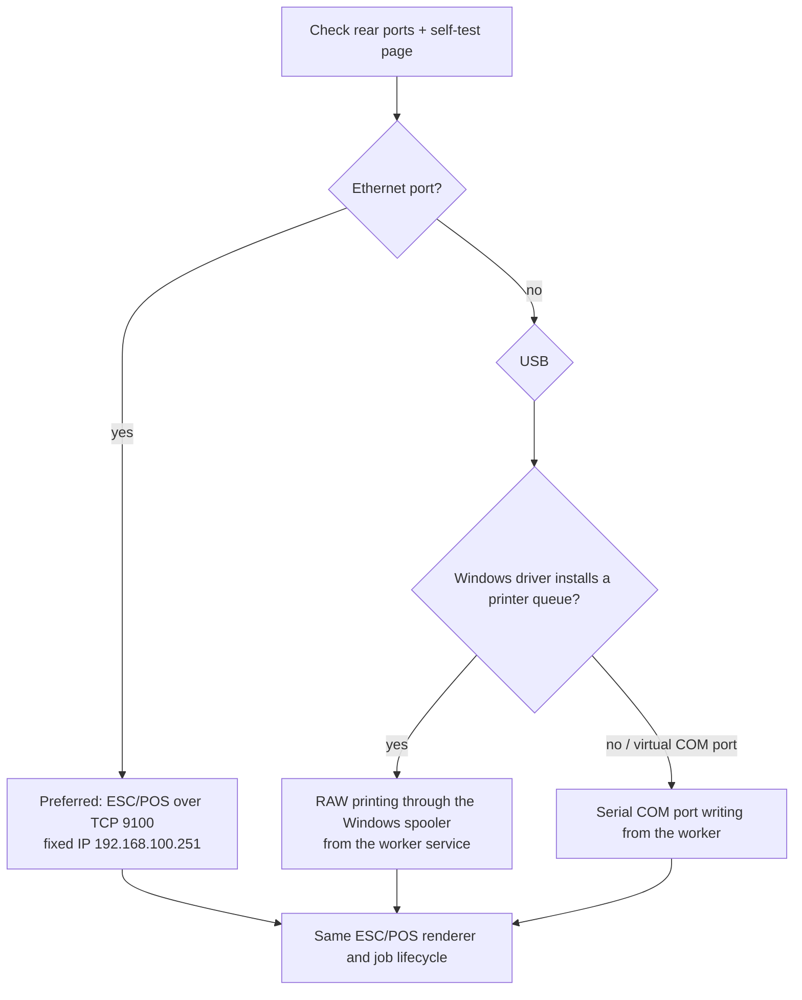
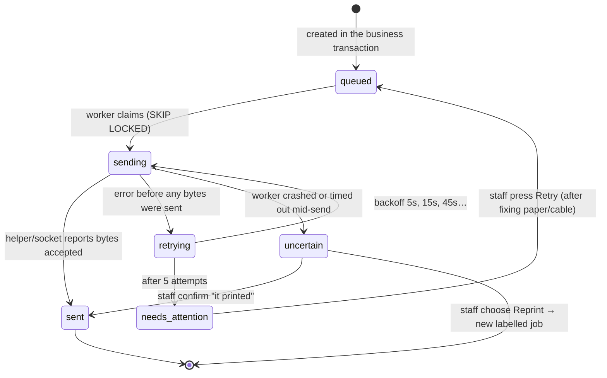

# Coffee Lounge — Printing & Hardware Plan (Phase 1, package 1C)

> Design specification for review R3. **Hardware status: nothing has been tested yet.** Printer connection type and ESC/POS behaviour are unknown until the rear-port photo and self-test page arrive (D-03, deferred by owner; needed before Phase 3 printing work). Until then every printing claim here is **design only, not verified**.

## 1. Hardware inventory

| Device | Model | Connection | Role | Status |
|---|---|---|---|---|
| Thermal printer | Sonic SNC-101, 80 mm | Unknown (USB expected) | Kitchen tickets + receipts + refund slips + shift reports | **Unverified** |
| Cash drawer | — | — | None installed | Not built, not claimed |
| Barcode scanner | Sonic SNC-930D, wired | USB expected (keyboard emulation) | Stock receiving/lookup on the counter PC | **Unverified** |
| Card terminal (counter) | HBL | Standalone | Card payments; slip reference typed in | Not integrated (by design) |
| Card terminal (portable) | HBL (D-37) | Standalone | Card on delivery | Not integrated (by design) |
| Kitchen display | — | — | None (D-33: Picked up on staff devices) | — |
| Waiter tablets | 3 × model unknown | Wi-Fi | Staff app | Models deferred |

## 2. Printer connection decision



**Expected path: USB via the Windows spooler (F).** The printer sits next to the server, so a USB cable is fine. The worker service hands raw ESC/POS bytes to the Windows print queue in **RAW** mode through a small helper (`cl-rawprint.exe`, a few dozen lines calling the Windows print API). The helper is bundled with the installer and returns clear exit codes. A service account must have permission to print to that queue; the installer sets this and the test print proves it.

Rejected: browser printing (`window.print()`), which has no durability, no control over cutting and prints from whichever screen happened to be open.

## 3. ESC/POS rendering

| Item | Design |
|---|---|
| Width | 80 mm paper, 576 dots, Font A → **48 characters per line** (configurable per printer; 58 mm = 32 chars) |
| Code page | CP437/CP1252 for English text (**VERIFY** on self-test page) |
| Urdu / Arabic script | Thermal printers generally can't print Urdu as text. Item names with Urdu script would need to be **printed as an image** (bitmap rendering). **Launch: print the English name on tickets and receipts**; Urdu rendering is a later option (D-27) |
| Logo | Monochrome bitmap, max 576 dots wide, from branding settings; optional |
| Cutting | Partial cut after each document, if supported (**VERIFY**) |
| User text | Notes, names: control characters stripped, lines wrapped at 48 chars |
| Prices on kitchen tickets | **Structurally impossible**: the kitchen renderer receives a data object with no price fields (DATABASE.md I-12), and a golden-file test fails if the output contains a currency marker ("Rs") or any decimal amount pattern (e.g. `650.00`) |

## 4. Document layouts (80 mm, 48 chars)

**Kitchen ticket** (template `kitchen`, printed automatically on acceptance, PROVISIONAL D-17):

```text
================================================
KITCHEN                               K-1019-118
T5 · DINE-IN                  ROUND 3 · ADD-ON
19 Oct 2026 14:02                Accepted: Sara
------------------------------------------------
2 x Cappuccino (Regular)
    + Oat milk
    + Extra shot
    ** NOTE: less foam, very hot **
1 x Club Sandwich
------------------------------------------------
Collect & tap "Picked up"
================================================
```

Variants: `TAKEAWAY · T-0123 · Ali` / `DELIVERY · D-0045` headers. **CORRECTION** and **VOID** tickets print a full-width banner, the original ticket number and the affected lines only. Reprints add `*** REPRINT #2 ***` at the top.

**Customer receipt** (template `receipt`, printed at settlement):

```text
                  [ LOGO ]
                COFFEE LOUNGE
         <address line>  ·  <phone>
------------------------------------------------
Invoice: INV-2026-000123             Table: T5
19 Oct 2026 14:35                 Cashier: Ali
------------------------------------------------
2  Cappuccino Regular                 1,300.00
     Oat milk ×2                        300.00
1  Club Sandwich                        950.00
------------------------------------------------
Subtotal                              2,550.00
Discount (Staff 10%)                   -255.00
Rounding                                  0.00
TOTAL                              Rs 2,295.00
Cash                                  3,000.00
Change                                  705.00
------------------------------------------------
          Thank you — see you again!
```

Card payments print `Card (HBL) ref 123456`. Transfers print `JazzCash ref TX…`. COD receipts for riders print `CASH TO COLLECT: Rs 2,295.00` and the rider's name. Settled-invoice reprints show `*** REPRINT #n ***`. Refund slips show the refund number, original invoice, lines/amount, method and approver.

**Shift report** (printed at shift close): opening float, cash sales, cash refunds, paid-in/out, expected cash, counted cash, variance, card total, transfer totals by provider, outstanding COD by rider.

Exact wording, logo and address lines are confirmed at design review R5 with your branding (D-27, OPEN-15).

## 5. Print job lifecycle



- **"Sent" means the printer or spooler accepted the bytes, not that paper came out.** USB printers behind the Windows spooler often can't report paper-out reliably. If the self-test shows the printer supports status queries, the worker will also poll status.
- Jobs are printed **in creation order** per printer, so a kitchen ticket created before a receipt prints before it.
- Business state never depends on printing. An accepted order stays accepted, and the kitchen ticket is always visible on staff screens (Kitchen tickets list) for pickup.

## 6. Single-printer failure handling

With one printer for everything, a paper-out stops kitchen tickets **and** receipts together:

| Situation | What staff see | What they do |
|---|---|---|
| Paper out / cover open / unplugged | Red printer banner on the counter PC and on staff devices (`printers` alerts), with queued job count | Fix paper; press **Retry all**. Queued jobs print in order, once |
| Long outage | Kitchen tickets readable on any staff device (Kitchen tickets list) | Kitchen works from the screen; reprint later if needed |
| Uncertain job after a crash | "Did ticket K-1019-118 print?" prompt | **Yes** → done; **No** → labelled reprint |

Training note: keep spare 80 mm rolls at the counter.

## 7. Barcode scanner (Sonic SNC-930D)

| Setting | Required | How to check |
|---|---|---|
| Interface | USB keyboard (HID) | Scan into Notepad: digits appear |
| Suffix | **Enter** after each scan | Cursor moves to a new line after a scan |
| Keyboard layout | US (matches Windows layout) | Letters/digits appear correctly |
| Symbologies | EAN-13, EAN-8, UPC-A, Code 128 at least | Scan sample supplier products |

The inventory screens keep a scan field focused. Fast keystrokes ending in Enter are treated as a scan, so scanning works without clicking first. Unknown barcodes open "link to item"; duplicates are refused (DATABASE.md `barcodes` unique index).

## 8. Verification sheet (filled in during Phase 3 / Phase 7)

| Check | Result | Evidence |
|---|---|---|
| Rear ports of SNC-101 (USB / LAN / serial / RJ11) | ☐ | Photo |
| Self-test page: firmware, interface, code page, ESC/POS emulation | ☐ | Photo |
| Windows 10 driver installs; queue name | ☐ | Screenshot |
| RAW print from the worker **service account** | ☐ | Test print |
| Kitchen ticket golden output matches §4 | ☐ | Photo |
| Receipt golden output matches §4, totals right-aligned | ☐ | Photo |
| Partial cut works | ☐ | — |
| Paper-out detected? (or documented as not detectable) | ☐ | Diagnostics screenshot |
| Unplug during a print → retry → no lost/duplicated ticket | ☐ | Log |
| Scanner: suffix Enter, symbologies on 5 real products | ☐ | Scan log |
