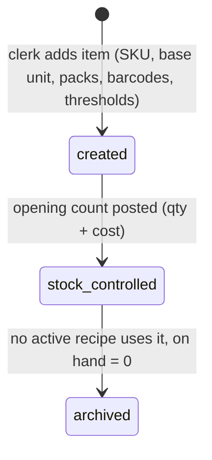

# Coffee Lounge — Recipe & Inventory Rules (Phase 1, package 1D)

> Design specification for review R4. Tables: [DATABASE.md](DATABASE.md) §5, §8. Transitions: [ORDER_STATE_MACHINE.md](ORDER_STATE_MACHINE.md) §3, §5, §8. Costing: [COST_VALUATION.md](COST_VALUATION.md). All quantities and prices in examples are **illustrative**, not Coffee Lounge data.

## 1. Units of measure

| Rule | Detail |
|---|---|
| Base units | Every inventory item is stored in exactly one base unit: **g**, **ml** or **pcs** |
| Allowed conversions | kg ↔ g (×1000), l ↔ ml (×1000). Count items have no conversion. |
| Forbidden | Mass ↔ volume (g ↔ ml). An item bought by weight but used by volume must be recorded in one unit only (e.g., record syrup in ml and enter receipts in ml) |
| Pack sizes | Purchase packs are defined per item: "1 L carton" = 1000 ml, "Tray of 30" = 30 pcs. Receiving shows the conversion explicitly: `6 × 1 L carton = 6,000 ml` |
| Precision | Quantities stored to 4 decimal places in base units; displayed to sensible precision (g/ml as whole numbers unless < 10) |
| Rounding | Half-up to 4 dp after every multiplication |

## 2. Item lifecycle and weekly data entry (D-29)

The clerk adds data every week, so items and recipes come online gradually. The system makes this safe:

| Rule | Why |
|---|---|
| An item becomes **stock-controlled** only when its opening count (quantity + unit cost) is posted | Stock and cost start from a known truth |
| A menu variant can switch from **untracked** to **recipe** only when it has an active recipe **and every ingredient in it is stock-controlled** | No half-tracked drinks; COGS for a tracked line is always complete |
| An item used by an active recipe can't be archived or taken out of stock control | Prevents silently breaking live recipes |
| Untracked variants sell normally (no reservation, no consumption, no blocking) | The shop can go live before all recipes are entered |
| Reports show **COGS coverage %** = share of net sales from recipe-tracked lines | The owner can see how complete the cost data is |

Suggested weekly order for the clerk: (1) items + packs + barcodes, (2) opening count for those items, (3) recipes that use only counted items, (4) activate recipes and switch variants to **recipe** mode. Start with the best-selling drinks (milk, beans, cups first).

## 3. Item settings

| Setting | Meaning |
|---|---|
| `track_lots` | Receipts create lots; consumption picks lots FEFO |
| `track_expiry` | Lots need an expiry date; expired lots don't count as available (requires `track_lots`) |
| `low_threshold` | Alert when available ≤ this |
| `overstock_threshold` | Alert when on hand ≥ this (excess stock) |
| `near_expiry_days` | Alert when a lot expires within N days |

Recommended: lots + expiry for milk, cream, bakery and other perishables; neither for cups, sugar sachets and similar.

## 4. Recipes

### 4.1 Versions
- Each sellable **variant** (e.g., Cappuccino · Regular) has recipe versions: **draft → active → retired**.
- Active versions are frozen. Editing creates a new draft (copied from the active one). Activating the draft retires the previous version **immediately for future acceptances**.
- Rounds accepted earlier keep the version they were accepted with (`order_line_components` snapshot). Pending rounds use whichever version is active **at acceptance**.
- Activation requires `recipes.manage`, is audited, and checks §2's rule (all ingredients stock-controlled).
- As built (Phase 4 step 4.8): a size has one draft at a time; saving replaces the draft's whole ingredient list; quantities may be entered in any unit of the ingredient's dimension and the waste factor as a percentage. Rules added by a choice must add or replace in counted ingredients, and a replacement keeps the same kind of unit. The editor's preview uses the same explosion as acceptance.

### 4.2 Components
Each component: ingredient, quantity in base unit, optional **waste factor**, and which order types it applies to (e.g., cup + lid only for takeaway and delivery).

**Waste factor** = the extra fraction normally lost in preparation (steam wand, spillage). Required quantity = `qty × (1 + waste_factor)`. Example: 150 ml milk with 5 % → 157.5 ml reserved and consumed.

### 4.3 Modifier recipe rules
Modifiers change ingredients as well as price (MENU-004):

| Action | Example | Effect |
|---|---|---|
| `add` | Extra shot | + 9 g espresso beans |
| `remove` | No sugar | Remove the sugar component |
| `replace` | Oat milk | Whole milk component → same quantity of oat milk |
| `scale` | Large-size syrup | Multiply that component by a factor |

Rules can apply to one variant or to every variant of the item. They are effective-dated, and accepted lines keep the rule results in force at acceptance.

### 4.4 Explosion algorithm (at acceptance)
For each line with stock mode **recipe**:
1. Take the active recipe's components that apply to the session's order type.
2. Apply the selected modifiers' rules in this order: **remove → replace → scale → add**. A modifier selected *n* times applies *n* times (adds/scales).
3. Apply each component's waste factor.
4. Aggregate per ingredient → `qty_per_unit` (rounded to 4 dp) → stored in `order_line_components`.
5. Requirement for the line = `qty_per_unit × line qty`.

**Worked example** (illustrative): Cappuccino · Regular, takeaway, with Oat milk + Extra shot.

| Step | Beans (g) | Whole milk (ml) | Oat milk (ml) | Cup + lid (pcs) |
|---|---|---|---|---|
| Recipe (takeaway) | 18 | 150 (waste 5 %) | — | 1 |
| Replace milk → oat | 18 | — | 150 (inherits 5 %) | 1 |
| Add extra shot (+9 g) | 27 | — | 150 | 1 |
| Waste factor | 27 | — | 157.5 | 1 |
| **qty_per_unit** | **27.0000** | — | **157.5000** | **1.0000** |
| × 2 cups | 54 | — | 315 | 2 |

## 5. Availability (what guests and staff see)

- A variant is **available** if, for every ingredient, `usable available ≥ qty_per_unit` for **one** unit with no modifiers. *Usable* excludes expired or quarantined lots for expiry-tracked items.
- A modifier option is unavailable if the ingredient it adds or replaces in is short for one unit.
- Availability is **advisory**. It's recomputed when stock changes (`availability.changed` event). The authoritative check is at acceptance, under row locks.
- Manual "temporarily unavailable" (e.g., machine broken) overrides stock-based availability.

## 6. Reservation and consumption math

| Event | Quantity |
|---|---|
| Reserve (acceptance) | `qty_per_unit × qty` per ingredient |
| Consume (Picked up *n* units) | `qty_per_unit × n`. **When the last units of a line are picked up, consume the exact remaining reservation** (`reserved − consumed − released`) so no rounding residue remains |
| Release (cancel *n* units not made) | `qty_per_unit × n`, with the same last-units rule |
| Cancel "already made" | Consume as Picked up, then classify as waste (no stock returned) |

### FEFO lot picking (lot-tracked items)
At consumption, take from lots ordered by **expiry date, then received date**, skipping quarantined lots. If non-expired lots don't cover the quantity (e.g., a lot expired between acceptance and pickup), the remainder is taken from the earliest expired lot. The movement is flagged `expired_lot_used` and an alert is raised. Physical reality is recorded, not hidden.

**Lots in practice (Phase 4 step 4.3):**

| Rule | Detail |
|---|---|
| Expired | A lot is expired from the business day after its expiry date (the printed date is the last day of use). Expired and quarantined lots are on hand but not usable: they do not count as available and cannot be reserved |
| Unknown expiry | A lot without a date (stock on hand when expiry tracking began without one, found stock) is usable and picked last |
| Where lots come from | A receipt line (one lot each), the opening balance, stock on hand when lots are switched on (one lot, with the expiry the clerk enters), and stock found at pickup |
| Waste | Waste can name a lot (an expired one); otherwise it is taken FEFO like a pickup. Waste only from expired lots is recorded as `expired_lot` waste |
| Reversing a receipt | Allowed only while the receipt's own lot still holds its quantity |
| Switching lots off | The quantity stays on the item; which lot it was in is forgotten |
| Alerts | The nightly expiry scan (04:05) raises one `near_expiry` or `expired` alert per lot and clears them when the lot is empty or no longer near; an alert recording that an expired lot went into an order stays until a person closes it |

## 7. Receiving stock (purchase receipts)

1. Clerk opens **Receive stock** (counter PC, off-peak, D-38): supplier (optional), supplier invoice reference.
2. Scan a barcode → item + pack size resolved. Or search by name/SKU.
3. Enter pack quantity → base quantity shown. Enter **line cost** (total paid for that line). Unit cost = line cost ÷ base quantity, to 8 dp.
4. Lot code and expiry date: required for expiry-tracked items.
5. **Post** → receipt number `GRN-YYYY-NNNNN`; lots created; stock and average cost updated (COST_VALUATION.md §3); alerts re-evaluated; availability refreshed.
6. If paid now: payment channel recorded and a ledger entry created. Otherwise unpaid supplier balances are **not tracked at launch** (PROVISIONAL D-19).

Unknown barcode → "Link to item" (choose item + pack size; needs `inventory.items_manage`). Duplicate active barcode → refused, showing which item already owns it.

**Corrections:** a posted receipt is never edited. Wrong quantity → reverse the receipt (allowed only if the stock is still on hand) and post a new one. Wrong price discovered later → **cost adjustment** (COST_VALUATION.md §5).

## 8. Waste

| Kind | Example | Stock movement | Cost |
|---|---|---|---|
| `ingredient` | Spilled milk, dropped beans | Yes, `waste` | Current average × qty |
| `expired_lot` | Milk lot expired | Yes, `waste` against that lot | Current average × qty |
| `prepared_item` | Drink remade, spilled after pickup, cancelled after being made | **No** (already consumed) | That line's consumption cost per unit |
| `failed_delivery` | Delivery cancelled after failure | **No** | Line consumption cost |

Reason codes (editable list): spilled, remade, expired, damaged, quality, customer refused, failed delivery, staff meal (if the owner wants it tracked as waste), other (note required).

## 9. Stock counts (D-18, PROVISIONAL)

| Step | Detail |
|---|---|
| Start | Choose scope (all items, a category, or a list). **Blind** by default: counters don't see the book quantity. |
| Count | Enter quantity per item (and per lot for lot-tracked items). The book quantity is snapshotted **when each line is entered**. |
| Submit | Variance per line = counted − book snapshot. Value = variance × current average. Lines over **2 % or Rs 1,000** are flagged for approval. |
| Approve | Owner/manager with `inventory.count_approve`, not the submitter. Can send lines back for recount. |
| Post | Each line posts a `count_adjustment` movement for the **variance (a delta)**, not an absolute overwrite, so sales during the count are not lost. |

**As built (Phase 4 step 4.5):** one count is open at a time. Submitting posts at once when no line is over the limits; otherwise the count waits for someone other than the submitter with `inventory.count_approve` (the owner by default), who approves here or by PIN on the counting device, or sends lines back (those lines are counted again, with a fresh book quantity). Lot-tracked items are counted per lot, plus a line for stock found in no known lot (it becomes a new lot, with an expiry if given). If more was sold after a line was counted than the count found missing, only what is still there is taken out, flagged `count_clamped`.

**Count below reserved quantity:** if posting makes `on_hand < reserved`, the adjustment is still posted (truth wins). A `reservation_shortfall` alert is raised, new acceptances needing that item are blocked, and a manager resolves the open orders (cancel or confirm they were already made).

## 10. Alerts

| Alert | Trigger | Next step offered |
|---|---|---|
| Low | available ≤ low threshold | "Add to reorder note" / Receive |
| Zero | available ≤ 0 → dependent variants unavailable | Receive / mark menu items unavailable |
| Near expiry | lot expires within N days | Use first / record waste |
| Expired | lot past expiry (nightly 04:05 + on demand) | Record waste (lot already excluded from availability) |
| Overstock | on hand ≥ overstock threshold | Review purchasing |
| Reservation shortfall | count posted below reserved | Resolve open orders |
| Stale reservation | reservation open > 12 h | Cancel or mark made |
| Uncollected item | accepted line not picked up after 30 min | Pick up or cancel |
| Balance mismatch | nightly check: balance ≠ Σ movements | Owner investigates (critical; never auto-fixed) |

Only one open alert per item and kind exists at a time (database rule). Alerts resolve automatically when the condition clears, except balance mismatch, which the owner must resolve manually.

**As built (Phase 4 step 4.7):** low, zero, shortfall and overstock are re-checked with every stock change and when an item's thresholds change; near expiry and expired per lot by the 04:05 scan; archiving an item closes its alerts (not a balance mismatch). Besides the balance mismatch (owner), two more are closed by a person because their condition never clears: found stock at a pickup, and an expired lot that went into an order (anyone who counts stock, with a note, audited). Any alert can be noted as seen. The Inventory area opens on the overview of all of this.

## 11. Supplier returns

Return of unused stock to a supplier: `supplier_return` movement against the original receipt line (and lot), valued at the **current average** (COST_VALUATION.md §4). Refund received → ledger entry `cash_in` with reference.

As built (Phase 4 step 4.4): a line can be returned in parts, never more than it brought in; a lot-tracked item comes out of the line's own lot, anything else out of what is available (accepted orders stay covered). The refund's amount, channel and reference are recorded on the return now; the ledger entry is written in Phase 5 (P4-2). A receipt with returns is no longer reversed: the rest is returned or wasted.
