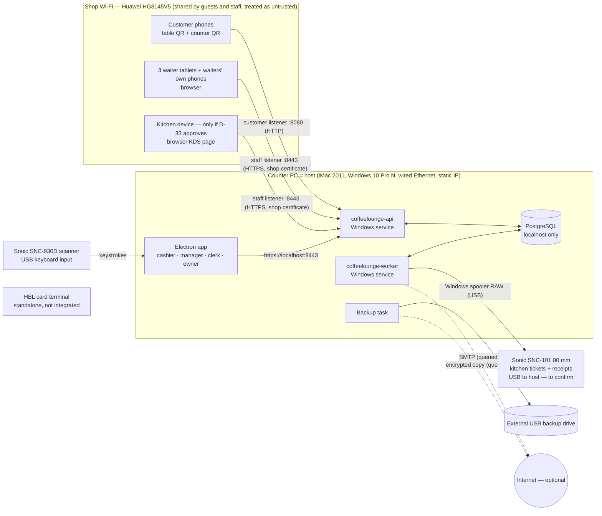
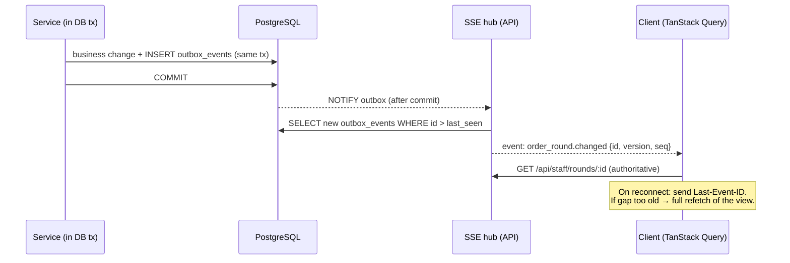

# 02 — Proposed System & Deployment Architecture

> Phase 0 · Draft for approval. Nothing here is implemented. Library choices are **RECOMMENDED** and get frozen at the Phase 1 gate.

## 2.1 Design principles

1. **One host, one database, one source of truth.** Every device is a thin client of the on-premises API. No client-side write queues, no peer sync, no "offline mode" on tablets that could later conflict.
2. **Modular monolith.** One Node.js codebase with explicit domain modules. Two processes (API, worker) for fault isolation. No microservices, message brokers, Redis or Kubernetes.
3. **PostgreSQL does the hard parts.** Transactions, row locks, unique constraints, partial indexes, `SKIP LOCKED` job claiming and `LISTEN/NOTIFY` cover concurrency, idempotency and job durability without extra infrastructure.
4. **HTTP for every write; push for hints only.** Server→client events tell clients *what changed*; clients refetch authoritative state. Events never carry business truth.
5. **Nothing depends on the internet.** No CDNs, web fonts, map tiles, telemetry or license checks. Email and optional off-site backup are queued outbound tasks that tolerate days of outage.
6. **Electron is a client, not the server.** Closing the reception app must not affect any other device.

## 2.2 Context diagram

> **Decision update (19 Oct 2026):** the host is the **counter/reception PC** (iMac 2011, Windows 10 Pro N, no UPS). There is **one Wi-Fi** shared by guests and staff, **one 80 mm printer** at the counter for kitchen tickets and receipts, **no cash drawer** and **no kitchen screen** (D-33 open). The diagram reflects this topology.



## 2.3 Technology stack (RECOMMENDED)

| Layer | Choice | Why | Rejected alternatives |
|---|---|---|---|
| Language | TypeScript end-to-end, strict mode | Shared types/validation between client and server | — |
| Repo | pnpm workspaces monorepo: `apps/server`, `apps/web`, `apps/desktop`, `packages/shared`, `packages/print-templates` | One version, shared domain constants and schemas | Separate repos (version drift) |
| HTTP server | **Fastify** | Fast, schema-first validation, mature plugin model, OpenAPI generation | Express (no schema-first validation), NestJS (heavier than needed) |
| Validation & contracts | **Zod** schemas in `packages/shared` → Fastify + generated OpenAPI | One definition for client forms, server validation, API docs | — |
| DB access | **Kysely** (typed SQL builder) + `pg` | Explicit transactions, `FOR UPDATE`, `SKIP LOCKED`, CTEs, partial indexes, raw SQL where needed — without ORM magic | Prisma (weak at row locking and advanced constraints), TypeORM (implicit behaviour) |
| Migrations | Plain, forward-only **SQL migrations** (node-pg-migrate or Kysely migrator) checked into the repo | Constraints, triggers and partial indexes are first-class; reviewable | ORM auto-sync (unsafe in production) |
| Decimal math | **decimal.js** wrapper (`Money`, `Qty`, `UnitCost` value types) | `pg` returns NUMERIC as string; never convert to JS `number` for money/qty | Floats |
| Jobs | **graphile-worker** (Postgres-backed, `SKIP LOCKED`, `LISTEN/NOTIFY`, retries with backoff) | Durable jobs without Redis; enqueue in the same transaction as the business change | BullMQ (needs Redis) |
| Realtime | **Server-Sent Events** | Traffic is one-way server→client. Native browser reconnect with `Last-Event-ID`; plain HTTP; easy auth via cookie | WebSockets (bidirectional not needed; more state) |
| Frontend | React + Vite, React Router, **TanStack Query** (server state), small Zustand stores (cart, UI), react-hook-form + Zod | Server state is cached and invalidated by SSE hints | Redux (unneeded) |
| UI primitives | **Radix UI** primitives + **Tailwind CSS** with design tokens as CSS variables | Accessible, unstyled primitives; theming and branding swap via tokens | Heavy component kits that fight the brand |
| Charts | **Apache ECharts** (tree-shaken), owner/manager bundles only | Large-dataset performance, rich chart types, SVG renderer for PDF reuse | — |
| PDF | **pdfmake** (pure JS, runs in worker, no browser) + server-rendered SVG charts | Works offline on the host without Chromium | Puppeteer (bundles Chromium, heavier) |
| Printing | ESC/POS byte generation (own small renderer over a vetted encoder library) | Template engine must structurally exclude prices on kitchen tickets | Browser `window.print()` (no control, no durability) |
| Auth | Server sessions (opaque token, httpOnly cookie), **argon2id** password/PIN hashing | Simple revocation, no JWT pitfalls | JWT access tokens |
| Logging | **pino** JSON logs with correlation IDs, rotated files on host | Supportable without cloud | — |
| Tests | Vitest, real PostgreSQL for integration tests, fast-check (property tests), Playwright (multi-actor E2E), k6 (load) | See 08-quality-testing | Mocked DB for transactional tests |
| Desktop | **Electron** (current LTS-supported major), electron-builder NSIS installer | Loads the staff web app from the host; hardened | — |
| Windows services | **WinSW** wrapping a bundled Node runtime; PostgreSQL's own service | Restart policies, service dependencies, log rotation, XML config in repo | Startup-folder shortcuts (not a service), pm2 (not a Windows service manager) |
| Database | **PostgreSQL 17** (or 18 after compatibility check), Windows x64 | Mature Windows builds | SQLite (no row-level concurrency for multi-device), MySQL |

## 2.4 Backend module boundaries

```
apps/server/src/
  platform/           http, auth middleware, rbac guard, idempotency, db/tx helpers, outbox, sse hub, logging, config
  modules/
    identity-rbac/     users, roles, permissions, devices, sessions, PIN approval (step-up)
    menu-pricing/      categories, items, variants, modifiers, promotions, price resolution
    recipes/           recipe versions, components, modifier recipe deltas, UOM conversion
    tables-sessions/   tables, QR tokens, dining sessions, guest access
    orders/            rounds, lines, state machines, approval
    kitchen/           tickets, KDS queries, prep/serve transitions
    inventory/         items, lots, balances, reservations, movements, counts, waste, barcodes
    purchasing/        suppliers, purchase receipts (GRN), pack conversions
    checkout-payments/ invoices, discounts, payments, refunds, cash shifts, document numbering
    ledger-expenses/   ledger entries, expenses, categories
    assets/            asset register, events, maintenance
    reporting/         KPI definitions, report queries, exports
    printing/          printer configs, templates, print jobs, ESC/POS rendering
    notifications/     alerts (low stock, expiry, shortfall), outbox → SSE
    scheduling/        report schedules, email deliveries
    audit/             audit event writer + queries
    system/            settings, health, backup status, diagnostics
```

**Rules:**
- Controllers parse, authorise and call **one** service method. Services own transactions and state transitions. Repositories only run SQL.
- Cross-module calls go through service interfaces in a fixed direction: `orders → inventory, kitchen, menu-pricing, recipes`; `checkout → orders, ledger`; `reporting` reads, never writes. No cycles; a lint rule (dependency-cruiser) enforces it.
- Every business calculation exists **once**: price resolution in `menu-pricing`, recipe explosion in `recipes`, invoice totals in `checkout-payments`, KPI formulas in `reporting/definitions`.

## 2.5 Processes and Windows services

| Service | Contents | Start type | Recovery | Depends on |
|---|---|---|---|---|
| `postgresql-x64-17` | Database | Automatic | Restart on failure | — |
| `coffeelounge-api` | Fastify API (two listeners), SSE hub, static web assets | Automatic (delayed start) | Restart after 5 s, 10 s, 30 s; reset counter daily | PostgreSQL |
| `coffeelounge-worker` | graphile-worker: print jobs, outbox dispatch, report generation, email, alerts, nightly reconciliation, backup orchestration | Automatic (delayed start) | Same as API | PostgreSQL |
| Electron app | Reception/admin UI | User login (per-user auto-launch) | User relaunch | Host reachable |

- Services run under a dedicated **low-privilege local account** (or a virtual service account), not LocalSystem. The account has write access only to `C:\ProgramData\CoffeeLounge\{logs,backups,attachments}`.
- Separating the worker means a hung printer driver or a large PDF report cannot stall order entry.
- **Health:** `GET /health/live` (process up) and `GET /health/ready` (DB reachable, migrations current, worker heartbeat < 60 s, last backup age, printer job backlog). The diagnostics page in the owner app reads this.
- **Startup ordering:** the API refuses traffic (returns 503 with a clear message) until the DB is reachable and the schema version matches. Clients show "Server starting…" rather than errors.
- **Windows behaviour to configure on the host:** auto-login is *not* required for services; disable sleep/hibernate; set Windows Update active hours outside trading time; set the BIOS to power on after AC loss; UPS with USB shutdown signalling.

## 2.6 Host (decided 19 Oct 2026: reception PC)

**Chosen host:** Apple iMac 27" Mid 2011 (iMac12,2) running Windows 10 Pro N 22H2 (Boot Camp), Intel i5-2500S (4 cores), 16 GB RAM, 128 GB SSD, no UPS.

**Capacity:** CPU and RAM are adequate for the expected load (one shop, a few dozen devices). This is still to be confirmed by the Phase 7 benchmark (AC-PERF-1).

**Constraints and required mitigations:**

| Constraint | Consequence | Mitigation (in design) |
|---|---|---|
| **Windows 10 is out of support** (ended 14 Oct 2025; consumer extended updates ended 13 Oct 2026). The CPU doesn't meet Windows 11 requirements. | No security patches on the machine that holds all business data, on a Wi-Fi shared with guests | D-34: paid Extended Security Updates if available, plus hardening: firewall allow-list (8080/8443 only), PostgreSQL on localhost only, no file sharing/RDP, no web browsing or e-mail on this PC, standard (non-admin) Windows account for daily use. Plan a replacement host. The restore runbook works on any Windows PC. |
| **No UPS**, frequent power cuts | Every cut stops **all** devices; abrupt power loss risks SSD cache loss and file-system damage; the iMac may not restart by itself | D-35: UPS strongly recommended for **both** the PC and the router. PostgreSQL keeps `fsync=on`, `full_page_writes=on`. Continuous WAL archive + nightly dump to an external USB drive. Startup self-check runs after every boot. Verify "start up after power failure" on this iMac (normally set from macOS; may not be settable if macOS has been removed). |
| **128 GB SSD** | Windows + PostgreSQL + logs fit, but backups must **not** share this disk | External USB backup drive is mandatory (D-23); disk-space alerts at 80 %/90 %; log rotation; SSD health (SMART) check during setup |
| 2011 hardware (≈ 15 years old); this model generation has a known history of graphics-card failures | Hardware failure is more likely than on a new PC | Tested restore onto a different Windows PC (AC-REC-2) before go-live; keep the installer and latest backup on the USB drive |
| No TPM | BitLocker would need a password or USB key at **every** boot, which would block automatic restart after power cuts | No BitLocker on the OS disk (documented risk). **Backups are always encrypted.** The PC must be physically secured at the counter. |
| Same PC is the cashier station and the server | Closing or misusing the cashier session must never stop the server | Server runs as Windows services independent of the logged-in user. Staff are trained **never to shut down or restart the counter PC** during trading. Windows Update active hours set to trading hours. Sleep/hibernate disabled. |
| Wired Ethernet available on the iMac | — | Connect the host to the router by **cable**, not Wi-Fi |

**Owner decisions on these constraints (19 Oct 2026):**
- **D-34:** stay on this machine with Windows 10 and no extended updates for now; replacement to be planned later. **Accepted risk.** The hardening above is therefore mandatory, not optional.
- **D-35:** no UPS, no inverter/generator, and macOS is not installed. **Accepted risk:** every power cut stops the whole system until power returns and the PC has booted. Mitigations: (1) enable *"Restart automatically after a power failure"* in the Windows **Boot Camp Control Panel** if this iMac's Boot Camp drivers offer it (verify on site); otherwise staff press the power button after each cut. (2) Startup integrity check plus a "system back online" banner on all devices. (3) WAL archive + nightly dump on the USB drive. (4) A printed paper fallback order pad for cuts. The router also loses power, so staff devices go offline at the same time anyway.

### Original comparison (kept for reference)

| Criterion | A. Dedicated Windows mini-PC (host only) | B. Reception PC also hosts |
|---|---|---|
| Reliability | Not used interactively; fewer accidental shutdowns, updates, browsing or malware exposure | Staff use it all day; risk of shutdown, sleep, heavy apps, USB changes, user-installed software |
| Restart impact | Reboot affects nothing but the reboot window, which can be scheduled | Every reception reboot or crash takes **every device** down (QR, waiters, KDS) |
| Performance | Spare capacity for reports/backups | Reports and backups compete with the cashier UI at peak |
| Security | Can be locked down (no staff logins, BitLocker, firewall allow-list) | Staff access the same desktop as the database; harder to separate duties |
| Cost | Extra PC (indicative spec below) + UPS | No extra PC; UPS still needed |
| Printer topology | Network printers recommended; USB printers must be attached to the host | USB receipt printer/drawer naturally attached to the host |
| Recommendation | **Preferred** for production | Acceptable with mitigations: UPS, Windows account separation, no-sleep policy, "do not shut down" procedure, scheduled updates |

**Indicative minimum host spec (to validate by benchmark):** 4+ core x64 CPU (recent Intel i5 / Ryzen 5 class), 16 GB RAM, 512 GB NVMe SSD, gigabit Ethernet wired to the router, Windows 11 Pro (for BitLocker and Group Policy), UPS with ≥ 10 min runtime and USB signalling, plus a second physical backup target (external SSD or NAS).

## 2.7 Local networking

**Decided (19 Oct 2026):** guests and staff share **one Wi-Fi** on a PTCL-managed **Huawei EchoLife HG8145V5** (LAN 192.168.100.x). There is no network segmentation, so the server treats the whole Wi-Fi as untrusted. Specific requirements for this router:

- **Static IP set on the host itself**, outside the router's DHCP pool (e.g., pool .2–.199, host `192.168.100.250`). ISP-managed devices can be reset or reconfigured remotely, which can wipe DHCP reservations. A host-side static IP doesn't depend on the router's tables. QR codes encode this IP.
- **Wi-Fi client/AP isolation must be off** on the SSID guests use, or guest phones can't reach the host. This is checked on site.
- **Change the router's default admin password** (guests on the same Wi-Fi can reach `192.168.100.1`) and disable WPS. The owner keeps the router credentials; they are never put in project files.
- Host connected by **Ethernet cable**.

**Addressing (general rule).** The host needs a fixed IP (e.g., `192.168.10.5`). The QR code encodes the **IP-based URL** (e.g., `http://192.168.10.5:8080/t/<token>`), because local DNS names are not reliable on guest phones (many use DNS-over-HTTPS / Private DNS that bypasses the router). If the router supports local DNS and on-site tests pass, a short name can be added later. Changing the host IP means reprinting QR codes, so the IP must be reserved permanently.

**Two listeners on the API process:**

| Listener | Port | Exposes | Transport |
|---|---|---|---|
| Customer | 8080 | Customer SPA bundle + `/api/customer/*` only | HTTP (guest phones cannot trust a local CA; see below) |
| Staff | 8443 | Staff SPA bundles + `/api/staff/*` + `/events` (SSE) | HTTPS with a certificate from a **shop-local CA** installed on staff devices and trusted by Electron |

Customer routes are not mounted on the staff listener and staff routes are not mounted on the customer listener. A guest who discovers port 8443 still faces device registration + login.

**Wi-Fi segmentation (verify on site, D-11):**
- Best: separate **Guest SSID** and **Staff SSID/VLAN**, with a router rule letting guests reach only `host:8080`. Staff SSID has a strong WPA2/WPA3 password known only to staff.
- Common router pitfall: "guest network" modes often enable **client isolation**, which blocks guests from reaching the host entirely. QR ordering then fails even though phones are "on the Wi-Fi". This must be tested with the actual router before QR codes are printed.
- Captive portals can block the first page load; test with iOS and Android.
- Host firewall: allow inbound 8080 and 8443 from the LAN subnets only; PostgreSQL (5432) bound to `127.0.0.1` only.

**HTTPS trade-off (documented, RECOMMENDED):**
- Customer HTTP on the guest LAN carries only menu data and order submissions tied to an opaque session token. The risk (a guest on the same Wi-Fi sniffing another table's session token) is limited to placing orders that still need staff approval. This is accepted and documented, and the token rotates per session.
- Staff traffic carries credentials and must not be sniffable: HTTPS with the local CA. Installing the CA on each staff tablet is a one-time onboarding step (documented in setup). If a staff device cannot install the CA, it is not supported for staff use.
- Alternative (OPTIONAL, not recommended at launch): a public domain with a publicly trusted certificate whose DNS points to the private IP. It needs internet for certificate renewal and public DNS resolution, which contradicts the offline rule.

## 2.8 Realtime updates



- `outbox_events` has a monotonically increasing `id` used as the SSE sequence. Each event names **topics** (e.g., `kitchen`, `table:12`, `session:<id>`, `inventory.availability`) and the hub filters by the subscriber's permissions and scope (a customer only receives its own session topic).
- Payloads are **invalidation hints** (`{type, entityId, version}`), never totals or statuses for display. The client refetches.
- On reconnect the browser sends `Last-Event-ID`; the hub replays from the outbox if within retention (e.g., 24 h), otherwise it sends `resync` and the client reloads its views.
- Heartbeat comment every 15 s; clients show a "Reconnecting…" banner after 2 missed heartbeats and disable write buttons that need fresh state (e.g., Accept, Take payment) until resynced.
- Browsers allow ~6 HTTP/1.1 connections per origin; the app uses **one** SSE stream per tab. HTTP/2 on the staff listener removes this limit.

## 2.9 Background jobs & transactional outbox

- Business transactions **enqueue jobs in the same transaction** (graphile-worker supports this because its queue is a Postgres table). If the transaction rolls back, no job exists; if it commits, the job exists durably.
- Job types: `print.render_and_send`, `report.generate`, `email.send`, `alerts.evaluate`, `reconcile.inventory_balances` (nightly: balances = Σ movements), `backup.run`, `outbox.prune`.
- Each job has a **job key** for de-duplication (e.g., `print:ticket:8812:copy:1`).
- Retries: exponential backoff with caps; after N failures the job goes to `needs_attention` and shows on the diagnostics screen. Business state is never changed because a job failed (a failed kitchen print doesn't un-accept an order).

## 2.10 Printing architecture (hardware-dependent, D-03)

**Decided topology (19 Oct 2026):** one **Sonic SNC-101 80 mm** printer at the counter prints **both kitchen tickets (no prices, "KITCHEN" header) and customer receipts**. Staff carry kitchen tickets to the kitchen. There is **no cash drawer**, so drawer-kick support is not built or tested at launch. Because the printer sits next to the host, a **USB connection directly to the host** is the simplest reliable option (spooler RAW printing from the worker service, no print agent needed). Still to verify: the printer's ports, ESC/POS compatibility, Windows driver and code page. A printer **self-test page** (usually printed by holding the feed button while switching on) and a photo of the rear ports will answer most of this.

Consequence of a single printer: a paper-out or jam stops **kitchen tickets and receipts together**. The kitchen ticket is still visible on screen (Approvals/orders view, and the KDS page if D-33 adds a kitchen device), and staff are trained to keep spare paper rolls at the counter.

### General printing design

- **Preferred:** Ethernet/Wi-Fi thermal printers that speak **ESC/POS over raw TCP 9100**. The worker sends bytes directly. Independent of host OS drivers, works from a Windows service, and supports status queries on many models (paper-out/cover-open via `DLE EOT`, model-dependent).
- **USB printers:** must be attached to the **host** for server-side printing. Printing goes through the Windows spooler in RAW mode. This needs verification per model/driver, and a service account must have access to the printer.
- **USB printer attached to a non-host reception PC:** needs a small **print agent** on that PC (the Electron app main process, or a mini service) that pulls jobs from the API. This adds a component. Avoid by choosing network printers or making reception the host.
- **Cash drawer:** normally connected to the receipt printer's RJ11/RJ12 port and opened by an ESC/POS pulse command. A drawer kick is a print job with an `authorised_event_id` (cash payment, or permissioned "no sale" with reason).
- **Print job lifecycle:** `queued → rendering → sending → sent | failed → retrying → needs_attention`. "Sent" means the bytes were accepted by the printer socket/spooler. **Not** a guarantee that paper came out. Status polling is used where supported. Staff can trigger a **controlled reprint**, which creates a new job with `copy_no` and a printed "REPRINT #n" banner. It never creates a new ticket or order.
- Kitchen ticket printing does **not** gate the KDS: the KDS screen shows the ticket from the database whether or not paper printed.

## 2.11 Electron (reception/admin shell)

- Loads `https://<host>:8443/app` (the same staff web app); no business logic in the main process.
- `contextIsolation: true`, `nodeIntegration: false`, `sandbox: true`, strict CSP, navigation locked to the host origin, `window.open` denied, no remote module.
- Preload exposes a minimal typed API: `getAppVersion`, `openDiagnostics`, `setHostAddress` (first-run setup), and *only if needed* `printAgent` for local USB printers.
- Trusts the shop-local CA via certificate pinning on the host origin (not by disabling TLS checks globally).
- If the host is unreachable, shows a branded "Server unavailable — check the host PC" screen with retry, never a blank window.
- Auto-launch at Windows login (per-user). This is a convenience only. The core services do not depend on it.

## 2.12 Offline behaviour and failure modes

| Failure | What keeps working | What the UI shows | What stops |
|---|---|---|---|
| Internet down, LAN + host up | Everything operational: QR, waiter, KDS, printing, checkout, inventory, reports | Small "Internet offline — emails queued" indicator in owner/diagnostics only | Outbound email, optional off-site backup copy (queued) |
| One client device loses Wi-Fi | Other devices | That device: "Reconnecting…" banner; write buttons disabled; carts kept locally | That device's submissions (no offline queue, by design) |
| Printer offline/paper-out | Orders, KDS screen, checkout | Print job error on KDS/reception/diagnostics; reprint button | Paper output only |
| Worker service crash | Ordering, KDS screen, checkout (API) | Diagnostics shows worker down; prints delayed | Printing/emails/report jobs until auto-restart (jobs resume, none lost) |
| API crash | Nothing (restart within seconds) | Clients: "Server reconnecting" | All operations until restart |
| Host/DB/power/LAN failure | **Nothing** — explicitly not supported (SRS §1.3) | Clients: "Server unavailable" | All operations. Fallback is a paper procedure (documented in training) |
| Unexpected power loss on host | On restart: all committed data (PostgreSQL WAL durability with `fsync=on`, `synchronous_commit=on`), **provided the SSD honours write flushes**. Consumer SSDs without power-loss protection can lose recently written data on abrupt cuts, which is why a UPS is recommended (D-35) and WAL is archived off-disk | — | Uncommitted requests fail; clients retry with the same idempotency key. **Decided host has no UPS:** every power cut stops the whole system until the PC is back up (and someone may need to press the power button). |

**Paper fallback procedure (RECOMMENDED):** a printed emergency order pad and price list. After recovery, a manager enters the orders as "manual back-entry" with a reason code and the original time, flagged in reports.

## 2.13 Backup & recovery (D-23 for targets)

| Layer | Mechanism | Frequency | RPO (proposed) |
|---|---|---|---|
| Continuous | PostgreSQL **WAL archiving** (`archive_mode=on`, `archive_timeout=300s`) to a second physical disk. **Decided host: external USB drive, mandatory** (the host has a single 128 GB SSD and no UPS) | Continuous | ≤ 5 min (if the archive disk survives) |
| Base backup | `pg_basebackup` | Weekly + after upgrades | — |
| Logical | `pg_dump -Fc` (portable, version-independent restore) | Nightly, outside trading hours | ≤ 24 h |
| Encryption | Backups encrypted (e.g., `age` with a public key; private key held by owner offline) | Every backup | — |
| Off-site | Copy encrypted dump to owner's cloud folder/USB rotation (queued if offline) | Daily, when internet available | ≤ 24–48 h for site loss |
| Verification | Automated `pg_restore --list` + periodic restore into a scratch database with integrity checks | Weekly automated; manual drill quarterly | — |
| Retention | e.g., 14 daily, 8 weekly, 12 monthly (configurable) | — | — |

Restore runbook covers: replacement PC install → install package → restore latest base backup + WAL replay (point-in-time) **or** latest `pg_dump` → run integrity checks (balances vs movements, invoice totals vs lines, payment sums) → re-point printers → reprint QR codes only if the IP changed.

**RTO (proposed, to verify by drill):** ≤ 2 hours with a spare PC and the installer on hand.

## 2.14 Upgrades & migrations

- Versioned installer (`CoffeeLounge-Setup-x.y.z.exe`): stops services → takes a pre-upgrade `pg_dump` → applies forward-only SQL migrations in one transaction where possible → starts services → health check. On failure: restore the pre-upgrade dump and reinstall the previous version (documented rollback).
- Migrations must be backward-compatible with the previous app version during the upgrade window (expand → migrate → contract across releases).
- Upgrades are done outside trading hours; the installer refuses to run while there are open sessions unless the owner overrides.
