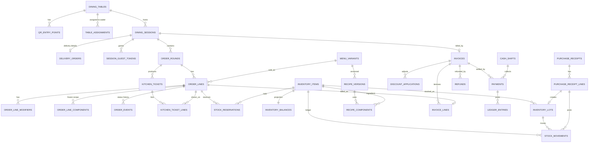

# 03 — Database & ERD Proposal (Preliminary)

> Phase 0 · **Not a migration.** This is the candidate model for the Phase 1 ERD review. Updated 19 Oct 2026: weighted-average costing (D-04), delivery (D-05), counter QR (D-05b), whole-round rejection (D-06) and table-assignment acceptance (D-07) are now reflected. The schema is still not frozen until Phase 1 sign-off (D-12, D-33 and D-37 affect it).

## 3.1 Conventions

| Topic | Rule |
|---|---|
| Primary keys | `bigint GENERATED ALWAYS AS IDENTITY`. Single database, so no distributed ID generation is needed. Internal IDs are never exposed to customers. |
| Customer-facing identifiers | QR tokens and guest tokens are 128-bit random values (base64url). Only a **SHA-256 hash** is stored, so a database leak can't be replayed as live tokens. |
| Human numbers | Order round `R-0042`, ticket `K-118`, invoice `INV-2026-000123`, receipt `GRN-…`, refund `RF-…`. Generated from `document_counters` under a row lock in the same transaction, so they are **gapless and collision-free**. Invoice numbers are assigned **at settlement**, not when a bill is opened, so there are no gaps from abandoned bills. |
| Time | All instants are `timestamptz` (UTC). Every financial/stock row also stores `business_date date`, computed by the service from the shop timezone + day cutoff (D-22) **at write time** and never recomputed. |
| Money | `NUMERIC(14,2)` (PKR). Rounding: **half-up to 2 dp** at line level; invoice totals are sums of rounded lines; optional cash rounding is recorded as an explicit `rounding_adjustment`. |
| Quantities | `NUMERIC(18,4)` in the item's **base unit** (g, ml, pcs). Order line quantity is a whole number of sellable units (`integer`). |
| Unit cost | `NUMERIC(20,8)` per base unit (e.g., PKR 0.26578947 per ml). |
| Stock value | `NUMERIC(18,4)` internally; reports round to 2 dp at presentation only. |
| Optimistic concurrency | Mutable aggregates carry `version int`, incremented on every update; API mutations send `expectedVersion` where lost updates matter (e.g., menu edits, settings). |
| Soft state | Catalog rows (`menu_items`, `inventory_items`, `suppliers`, `dining_tables`, `users`) use `archived_at`/`status`. **Posted records are never deleted.** |
| Append-only | Enforced by (a) `BEFORE UPDATE OR DELETE` triggers that raise an exception and (b) the app DB role lacking `UPDATE/DELETE/TRUNCATE` on those tables. Corrections are new rows that reference the original (`reverses_id`). |
| DB roles | `cl_migrator` (DDL, used only by the installer), `cl_app` (DML with append-only restrictions), `cl_readonly` (reporting/diagnostics). |
| Extensions | `pg_trgm` (fuzzy search for menu/inventory names). Nothing else required. |

## 3.2 Core ERD (ordering, inventory, billing)

## 3.3 Table catalogue

Only key columns are listed. All tables also have `created_at`, and mutable tables have `updated_at`, `version`.

### Identity, RBAC, audit

| Table | Key columns | Constraints / indexes |
|---|---|---|
| `users` | `username`, `display_name`, `password_hash` (argon2id), `pin_hash` (nullable), `status` (active/disabled), `is_owner`, `failed_attempts`, `locked_until`, `must_change_password` | `UNIQUE (lower(username))`; at least one active owner enforced by service + trigger |
| `roles` | `key`, `name`, `is_system` | `UNIQUE(key)`; system roles can't be deleted |
| `permissions` | `key` (PK, e.g. `orders.accept`), `module`, `description`, `is_protected` | Seeded by migrations, not user-editable |
| `role_permissions` | `role_id`, `permission_key` | PK both |
| `user_roles` | `user_id`, `role_id` | PK both |
| `user_permission_overrides` | `user_id`, `permission_key`, `effect` (grant/deny), `reason`, `granted_by` | PK(user_id, permission_key); deny wins |
| `devices` | `name`, `kind` (waiter/kds/reception/manager/inventory), `ownership` (shop/personal), `token_hash`, `status`, `registered_by`, `last_seen_at` | `UNIQUE(token_hash)`. Personal phones (decided D-03) are registered like shop tablets and can be revoked instantly. |
| `staff_profiles` | `display_name`, `kind` (rider), `phone`, `user_id` (nullable: riders need no login, D-41), `is_active` | Riders are selectable at dispatch and appear in COD reports |
| `auth_sessions` | `token_hash`, `user_id`, `device_id`, `expires_at`, `revoked_at`, `last_seen_at` | `UNIQUE(token_hash)`; index `(user_id) WHERE revoked_at IS NULL` |
| `step_up_approvals` | `action`, `requested_by`, `approved_by`, `device_id`, `entity_type`, `entity_id`, `reason` | Append-only; referenced by the approved operation |
| `audit_events` | `occurred_at`, `actor_kind` (user/guest/system), `actor_user_id`, `device_id`, `action`, `entity_type`, `entity_id`, `before` jsonb, `after` jsonb, `reason`, `approved_by`, `correlation_id`, `ip` | **Append-only**; index `(entity_type, entity_id, occurred_at DESC)`, `(actor_user_id, occurred_at DESC)`, BRIN `(occurred_at)` |

### Menu, pricing, recipes

| Table | Key columns | Constraints / indexes |
|---|---|---|
| `menu_categories` | `name`, `sort`, `is_active`, `archived_at` | |
| `menu_items` | `category_id`, `name`, `description`, `image_path`, `allowed_order_types` (dine_in/takeaway/delivery flags), `station_id`, `is_active`, `archived_at` | trigram index on `name` |
| `menu_variants` | `item_id`, `name` (Small/Regular/Large), `price` NUMERIC(14,2), `is_stock_tracked`, `is_default`, `is_active` | `CHECK (price >= 0)`; `UNIQUE(item_id, name)` |
| `menu_variant_price_history` | `variant_id`, `price`, `effective_from`, `set_by` | Append-only |
| `modifier_groups` | `name`, `min_select`, `max_select` | `CHECK (min_select <= max_select)` |
| `modifier_options` | `group_id`, `name`, `price_delta`, `is_active` | |
| `menu_item_modifier_groups` | `item_id`, `group_id`, `sort` | PK both |
| `recipe_versions` | `variant_id`, `version_no`, `status` (draft/active/retired), `yield_qty`, `prep_instructions`, `activated_by`, `activated_at` | `UNIQUE(variant_id, version_no)`; **partial unique** `(variant_id) WHERE status='active'`; active versions are immutable (trigger) |
| `recipe_components` | `recipe_version_id`, `inventory_item_id`, `qty_base`, `waste_factor`, `applies_to_order_types` | `CHECK (qty_base > 0)` |
| `modifier_recipe_rules` | `modifier_option_id`, `variant_id` (nullable = all), `action` (add/remove/replace/scale), `inventory_item_id`, `replacement_item_id`, `qty_base`, `effective_from`, `retired_at` | Rules are versioned by effective dating; accepted lines snapshot the result |
| `promotions` | `name`, `kind` (percent/fixed), `value`, `scope` (item/category), `target_ids`, `starts_at`, `ends_at`, `days_of_week`, `time_from`, `time_to`, `is_active` | Scope pending D-14 |

### Tables, sessions, guest access

| Table | Key columns | Constraints / indexes |
|---|---|---|
| `dining_tables` | `code` (T05), `name`, `area`, `seats`, `availability` (active/blocked/maintenance), `sort`, `archived_at` | `UNIQUE(code)` |
| `qr_entry_points` (replaces `table_qr_tokens`) | `kind` (table / counter_takeaway), `table_id` (required for kind=table, null otherwise), `label`, `token_hash`, `is_active`, `revoked_at` | `UNIQUE(token_hash)`; `CHECK ((kind='table') = (table_id IS NOT NULL))`; partial unique `(table_id) WHERE is_active AND kind='table'` |
| `table_assignments` (D-07) | `table_id`, `user_id` (waiter), `assigned_by`, `assigned_at`, `ended_at` | **Partial unique `(table_id) WHERE ended_at IS NULL`** (one current waiter per table); index `(user_id) WHERE ended_at IS NULL`. History kept for staff reports. |
| `dining_sessions` | `session_no`, `order_type` (dine_in/takeaway/delivery), `table_id` (nullable), `status` (open/checkout_requested/checkout_locked/settled/cancelled), `guest_count`, `customer_name`, `customer_phone`, `delivery_*` (pending D-05), `opened_at`, `closed_at`, `business_date` | `CHECK ((order_type='dine_in') = (table_id IS NOT NULL))`; **`UNIQUE (table_id) WHERE status IN ('open','checkout_requested','checkout_locked')`** (one active session per table) |
| `session_guest_tokens` | `session_id`, `token_hash`, `last_seen_at`, `revoked_at` | `UNIQUE(token_hash)`; revoked when session closes. Counter-QR guests get a token bound to their **own** new takeaway session (never shared). |
| `delivery_orders` (D-05) | `session_id` (1:1, order_type=delivery), `channel` (phone/whatsapp/walk_in), `customer_name`, `customer_phone`, `customer_email`, `address`, `landmark`, `notes` (**all optional**), `payment_mode` (prepaid/cod_cash/card_on_delivery), `delivery_status`, `rider_staff_id`, `dispatched_at`, `delivered_at`, `failed_at`, `failure_reason`, `resolution` (reattempt/cancelled/converted_to_pickup), `resolved_by` | `UNIQUE(session_id)`; index `(delivery_status) WHERE delivery_status IN ('awaiting_dispatch','out_for_delivery','failed')` |
| `delivery_events` | `delivery_order_id`, `from_status`, `to_status`, `actor_user_id`, `rider_staff_id`, `reason`, `event_key`, `occurred_at` | **Append-only**; `UNIQUE(event_key)` |

> "Dining session" is used for **every** order type: a takeaway or delivery order is a session without a table. This gives one invoice model, one checkout flow and one set of reports.

### Orders and kitchen

| Table | Key columns | Constraints / indexes |
|---|---|---|
| `order_rounds` | `session_id`, `round_no`, `source` (qr/waiter/reception), `status` (pending_approval/accepted/rejected/cancelled), `submitted_by_user_id` / `submitted_by_guest_token_id`, `idempotency_key`, `quoted_total`, `accepted_by`, `accepted_at`, `rejection_reason` | `UNIQUE(session_id, round_no)`; `UNIQUE(session_id, idempotency_key)`; partial index `(submitted_at) WHERE status='pending_approval'` (approval queue) |
| `order_lines` | `round_id`, `session_id`, `line_no`, `variant_id`, `item_name_snap`, `variant_name_snap`, `qty`, `unit_price_quoted`, `unit_price`, `modifiers_total`, `line_total`, `notes`, `recipe_version_id`, `station_id`, `fulfil_status`, `qty_ready`, `qty_served`, `qty_cancelled_unprepared`, `qty_cancelled_prepared`, `billable` | `CHECK (qty > 0)`; `CHECK (qty_ready + qty_cancelled_unprepared <= qty)`; `CHECK (qty_served <= qty_ready)`; `CHECK (qty_cancelled_prepared <= qty_ready - qty_served)` … (exact invariants finalised in Phase 1); prices immutable once accepted (trigger) |
| `order_line_modifiers` | `line_id`, `modifier_option_id`, `name_snap`, `price_delta_snap`, `qty` | |
| `order_line_components` | `line_id`, `inventory_item_id`, `qty_per_unit_base`, `source` (recipe/modifier) | Written once at acceptance; immutable |
| `order_events` | `entity_type` (round/line), `entity_id`, `event_type`, `from_status`, `to_status`, `qty`, `actor_user_id`, `reason`, `event_key`, `occurred_at`, `correlation_id` | **Append-only**; **`UNIQUE(event_key)`**: the idempotency anchor for accept/ready/serve/cancel transitions |
| `stations` | `name` (Bar/Kitchen), `printer_id`, `kds_enabled` | Pending G-03 |
| `kitchen_tickets` | `ticket_no`, `round_id`, `station_id`, `kind` (new/supplement/correction/void), `supersedes_ticket_id`, `status` (new/preparing/ready/completed/cancelled), `template_version_id` | Partial unique `(round_id, station_id) WHERE kind='new'` (one original ticket per round per station); index `(station_id, status, created_at) WHERE status IN ('new','preparing','ready')` |
| `kitchen_ticket_lines` | `ticket_id`, `order_line_id`, `qty`, `display` jsonb (names, modifiers, notes — **no price fields**) | |
| `ticket_templates` | `kind` (kitchen/receipt/round_slip), `version`, `definition` jsonb, `is_active` | Kitchen template schema has no price placeholders (validated) |

### Inventory and purchasing

| Table | Key columns | Constraints / indexes |
|---|---|---|
| `uoms` | `code` (g, kg, ml, l, pcs), `dimension` (mass/volume/count), `factor_to_base` | Conversion only within the same dimension |
| `inventory_items` | `sku`, `name`, `base_uom` (g/ml/pcs), `track_lots`, `track_expiry`, `low_threshold`, `overstock_threshold`, `near_expiry_days`, `is_active`, `archived_at` | `UNIQUE(sku)`; trigram on `name` |
| `item_pack_sizes` | `item_id`, `name` ("1 L carton"), `qty_base` | `CHECK (qty_base > 0)` |
| `barcodes` | `code`, `item_id`, `pack_size_id`, `is_active` | **`UNIQUE(code) WHERE is_active`** (duplicate detection) |
| `inventory_balances` | `item_id` (PK), `on_hand`, `reserved`, *(WAC only)* `inventory_value`, `avg_unit_cost` | `CHECK (on_hand >= 0 AND reserved >= 0)`; `available = on_hand − reserved` computed. **The row-lock target for all stock operations.** |
| `inventory_lots` | `item_id`, `lot_code`, `received_at`, `expiry_date`, `qty_received`, `qty_remaining`, `receipt_line_id`, `status` (active/quarantined/depleted) | `CHECK (qty_remaining >= 0)`; index `(item_id, expiry_date, received_at) WHERE qty_remaining > 0` (FEFO pick order) |
| `stock_reservations` | `order_line_id`, `item_id`, `qty_reserved`, `qty_consumed`, `qty_released`, `status` (active/closed) | **`UNIQUE(order_line_id, item_id)`**; `CHECK (qty_consumed + qty_released <= qty_reserved)`; partial index `(item_id) WHERE status='active'` |
| `stock_movements` | `item_id`, `lot_id`, `movement_type` (opening/receipt/consumption/waste/count_adjustment/manual_adjustment/supplier_return/cost_adjustment/reversal), `qty_delta` (signed), `unit_cost`, `value_delta`, `source_type`, `source_id`, **`source_key`**, `reason_code`, `reverses_movement_id`, `actor_user_id`, `occurred_at`, `business_date` | **Append-only**; **`UNIQUE(source_key)`** (e.g. `consume:line:9912:evt:ab12:item:44:lot:7`); index `(item_id, occurred_at)`, `(source_type, source_id)`, `(business_date)` |
| `suppliers` | `name`, `phone`, `email`, `address`, `is_active` | |
| `purchase_receipts` | `receipt_no`, `supplier_id`, `supplier_invoice_ref`, `received_at`, `status` (draft/posted/reversed), `total_cost`, `posted_by`, `idempotency_key` | Lines immutable after posting |
| `purchase_receipt_lines` | `receipt_id`, `item_id`, `pack_size_id`, `pack_qty`, `qty_base`, `unit_cost_base`, `line_cost`, `lot_code`, `expiry_date` | `CHECK (qty_base > 0 AND line_cost >= 0)` |
| `stock_counts` / `stock_count_lines` | header: `status` (draft/submitted/approved/rejected/posted), `approved_by`; lines: `item_id`, `lot_id`, `book_qty_snap`, `counted_qty`, `variance_qty`, `variance_value` | Posting creates `count_adjustment` movements with `source_key = count:<id>:line:<id>` |
| `wastage_records` | `kind` (ingredient/prepared_item), `item_id`, `lot_id`, `order_line_id`, `qty`, `reason_code`, `cost_value`, `movement_id` | Ingredient waste creates a movement; prepared-item waste **classifies** existing consumption cost and creates no movement |
| `inventory_alerts` | `item_id`, `kind` (low/zero/near_expiry/expired/overstock/reservation_shortfall), `state` (open/acknowledged/resolved) | Partial unique `(item_id, kind) WHERE state <> 'resolved'` (no alert spam) |

**Costing structures. Decided 19 Oct 2026 (D-04): perpetual weighted-average.** FIFO layer tables will **not** be built.

| Structure | Purpose |
|---|---|
| `inventory_balances.inventory_value` NUMERIC(18,4), `avg_unit_cost` NUMERIC(20,8) | Running WAC value per item, updated under the same balance row lock as quantities |
| `stock_movements.unit_cost`, `value_delta` | Cost of every movement at posting time (receipts at purchase cost; issues at current average) |
| `order_line_costs(order_line_id, item_id, qty_base, value)` | Frozen actual COGS per sold line, written at consumption |
| `cost_adjustments(item_id, receipt_line_id, amount, to_inventory, to_variance, reason)` | Supplier price corrections posted in the current period (05-costing §5.4) |

### Checkout, payments, cash

| Table | Key columns | Constraints / indexes |
|---|---|---|
| `document_counters` | `kind`, `scope_key` (e.g. `2026`, `2026-10-18`), `next_value` | PK(kind, scope_key); `SELECT … FOR UPDATE` in the same tx |
| `invoices` | `session_id`, `invoice_no` (null until settled), `status` (open/locked/settled), `lock_version`, `subtotal`, `discount_total`, `tax_total` (=0), `rounding_adjustment`, `total`, `paid_total`, `locked_by/at`, `settled_by/at`, `business_date` | **`UNIQUE(session_id)`** (one bill per session); `UNIQUE(invoice_no)`; `CHECK (total = subtotal - discount_total + tax_total + rounding_adjustment)`; `CHECK (status <> 'settled' OR paid_total >= total)`; settled rows immutable (trigger) |
| `invoice_lines` | `invoice_id`, `order_line_id`, `description_snap`, `qty`, `unit_price`, `modifiers_total`, `gross`, `discount_alloc`, `net`, `is_comp` | `UNIQUE(order_line_id)` (a line can be billed once); immutable after settlement |
| `discount_applications` | `invoice_id`, `invoice_line_id`, `promotion_id`, `kind` (percent/fixed/comp), `value`, `amount`, `reason`, `applied_by`, `approved_by`, `voided_at` | |
| `payments` | `invoice_id`, `method` (cash / card_manual / **transfer**, D-37), `transfer_provider` (bank / jazzcash / easypaisa, required when method=transfer), `reference` (card: HBL slip approval code/RRN; transfer: transaction ID; ≤ 32 chars; validated **not** to resemble a card number; required for transfer), `confirmed_by` (staff who checked the transfer arrived; there is no bank/wallet integration), `amount`, `tendered`, `change_due`, `received_by`, `collected_by_rider_id` (COD: who held the money before handover), `cash_shift_id`, `idempotency_key` | **Append-only**; **`UNIQUE(idempotency_key)`**; `CHECK (amount > 0)`; `CHECK (method='cash' OR (tendered IS NULL AND change_due IS NULL))` |
| `refunds` | `refund_no`, `invoice_id`, `payment_id`, `amount`, `method`, `reason`, `requested_by`, `approved_by`, `cash_shift_id`, `idempotency_key` | Append-only; `UNIQUE(idempotency_key)`; service ensures Σ refunds ≤ Σ payments |
| `cash_drawers` | `name`, `printer_id` | |
| `cash_shifts` | `drawer_id`, `opened_by`, `opening_float`, `closed_by`, `counted_cash`, `expected_cash`, `variance`, `status` (open/closed/approved), `approved_by` | **`UNIQUE(drawer_id) WHERE status='open'`** |
| `cash_movements` | `shift_id`, `kind` (paid_in/paid_out/no_sale), `amount`, `reason`, `actor`, `approved_by` | Append-only |

### Finance and assets

| Table | Key columns | Constraints / indexes |
|---|---|---|
| `ledger_entries` | `entry_no`, `entry_type` (sale_receipt/refund/purchase_payment/expense/cash_in/cash_out/adjustment/reversal), `direction` (in/out), `amount`, `channel` (cash/card/bank/other), `category_id`, `business_date`, `source_type`, `source_id`, `source_key`, `reverses_entry_id`, `memo`, `created_by` | **Append-only**; `CHECK (amount > 0)`; **`UNIQUE(source_key)`**; index `(business_date)`, `(source_type, source_id)` |
| `expense_categories` | `name`, `kind`, `is_active` | |
| `expenses` | `expense_no`, `category_id`, `amount`, `payee`, `reference`, `business_date`, `paid_via`, `attachment_path`, `status` (recorded/voided), `void_reason` | Void = reversal ledger entry; original preserved |
| `assets` | `asset_tag`, `name`, `category`, `quantity`, `purchase_date`, `purchase_price`, `supplier_id`, `location`, `condition`, `responsible_user_id`, `status` (in_use/in_repair/retired/disposed) | `UNIQUE(asset_tag)` |
| `asset_events` | `asset_id`, `event_type` (acquired/moved/condition_changed/maintenance/value_corrected/disposed), `data` jsonb, `actor`, `occurred_at` | Append-only |
| `asset_maintenance` | `asset_id`, `performed_on`, `vendor`, `cost`, `description`, `next_due`, `expense_id` | |

### Infrastructure

| Table | Purpose / key constraints |
|---|---|
| `idempotency_keys` | PK `(scope, key)`; `actor_ref`, `request_hash`, `status` (in_progress/completed), `response_status`, `response_body`, `expires_at`. A replay with a **different** `request_hash` → `409 IDEMPOTENCY_KEY_REUSED`. |
| `outbox_events` | `id` (SSE sequence), `topics text[]`, `event_type`, `entity_type`, `entity_id`, `entity_version`; pruned after retention. |
| `printers` | `name`, `kind`, `connection` (tcp/spooler/agent), `address`, `paper_width_mm`, `chars_per_line`, `supports_status` |
| `print_jobs` | **`UNIQUE(job_key)`**, `printer_id`, `document_type`, `document_id`, `copy_no`, `is_reprint`, `requested_by`, `status`, `attempts`, `last_error`, `sent_at` |
| `report_schedules` / `report_runs` / `report_deliveries` | Schedule config; generated file; email status (`queued/sending/sent/failed`), `attempts`, `last_error`, `message_id` |
| `system_settings` | `key`, `value` jsonb; changes audited |
| `backup_runs` | `kind`, `status`, `path`, `size_bytes`, `verified_at`, `error` |
| `jobs` (graphile-worker schema) | Managed by the job library |

## 3.4 Key invariants and how each is enforced

| # | Invariant | Database guard | Service guard |
|---|---|---|---|
| I-1 | One active session per table | Partial unique index on `dining_sessions(table_id)` | Session lookup/creation under `FOR UPDATE` on the table row |
| I-2 | One bill per session | `UNIQUE(invoices.session_id)` | Invoice created lazily with `INSERT … ON CONFLICT DO NOTHING` |
| I-3 | A round is accepted at most once | Conditional update `UPDATE … SET status='accepted' WHERE id=$1 AND status='pending_approval'`; `UNIQUE(order_events.event_key)` | Idempotency key replay returns the original response |
| I-4 | One reservation per line×item | `UNIQUE(stock_reservations(order_line_id, item_id))` | — |
| I-5 | Reserved never exceeds on hand at acceptance | `CHECK (reserved >= 0)`; reservation check under `FOR UPDATE` of balance rows | `available >= required` evaluated after locking |
| I-6 | Consumption posted once per prep event | `UNIQUE(stock_movements.source_key)`; `CHECK (qty_consumed + qty_released <= qty_reserved)` | Prep transition is a conditional counter update |
| I-7 | Balance = Σ movements | Nightly reconciliation job; mismatch → critical alert | Balances only change in the same tx as a movement |
| I-8 | One original kitchen ticket per round/station | Partial unique on `kitchen_tickets` | — |
| I-9 | Payment posted once | `UNIQUE(payments.idempotency_key)` | Invoice row lock + remaining-due check |
| I-10 | Settled invoice immutable | Trigger blocks UPDATE on settled invoices/lines | Corrections only via `refunds` / ledger reversal |
| I-11 | No overpayment by retries | `paid_total` updated under invoice lock; `CHECK` | Payment amount ≤ remaining due (cash may tender more; change computed) |
| I-12 | Kitchen output never shows prices | Ticket line `display` jsonb produced from a typed DTO with no price fields; template schema validation | Snapshot test on rendered tickets |
| I-13 | Recipe edits don't alter history | Active recipe versions immutable (trigger); lines snapshot `order_line_components` | Editing creates a new draft version |
| I-14 | Every movement/ledger row has a source | `NOT NULL source_type, source_id, source_key` | — |
| I-15 | At least one active owner | Trigger on `users`/`user_roles` | Owner-protected operations |
| I-16 | One current waiter per table | Partial unique on `table_assignments(table_id) WHERE ended_at IS NULL` | Assignment changes are audited |
| I-17 | Only authorised staff can accept a given round; only one acceptance succeeds | Conditional update (I-3) | Acceptance-scope check in the same transaction (D-07) |
| I-18 | Delivery not marked delivered with an unpaid COD balance | — | Delivered transition requires settled invoice or a manager-approved exception |

## 3.5 Critical atomic operations (transaction boundaries)

**Global lock order** (prevents deadlocks; every transaction that touches several of these takes locks in this order):
`dining_tables → dining_sessions → order_rounds → order_lines → inventory_balances (ascending item_id) → inventory_lots (ascending id) → invoices → cash_shifts → document_counters`.

| Operation | Single transaction contents |
|---|---|
| **Submit round** (QR/waiter) | Idempotency check → resolve table→session (create if none, under table lock) → validate session status (open/checkout_requested if allowed) → server-side price resolution → insert round (pending) + lines + modifiers → order event → outbox (`approvals`, `session:<id>`). *(Waiter with `orders.accept`: continues straight into "Accept round" in the same tx — D-07.)* |
| **Accept round** | Lock session + round (`FOR UPDATE`) → assert `pending_approval` → **assert the actor may accept this round** (D-07: waiter = table currently assigned to them; cashier = takeaway/delivery, unassigned table, or escalated round per D-36; manager/owner = any). This is checked against `table_assignments` **inside the same transaction**, so a reassignment can't race the check → assert session not `checkout_locked` → re-resolve prices (apply price-lock rule D-08) → explode recipes + modifier rules into `order_line_components` → aggregate requirement per item → lock `inventory_balances` rows in item-id order → compute available (non-expired lots only for expiry-tracked items) → if any shortfall: **roll back** and return a structured `INSUFFICIENT_STOCK` result per line → else insert reservations, `reserved += qty` → round `accepted`, lines `accepted` → kitchen ticket(s) per station → print jobs → order events → outbox. |
| **Mark ready (prepared)** | Lock line → conditional `qty_ready += n` (bounded by CHECK) → lock balances (+ lots, FEFO) → insert consumption movements (`source_key` includes prep event key) → reservation `qty_consumed += n×component` → balance `on_hand −= …, reserved −= …` (+ value for WAC) → cost snapshot for the line → order event → outbox. Retry with same event key ⇒ unique violation ⇒ return stored result. |
| **Cancel before ready** | Lock line → `qty_cancelled_unprepared += n` → release reservation (`qty_released += …`, `reserved −= …`) → correction/void ticket + print job → event → outbox. Requires `orders.void` if already accepted. |
| **Cancel/comp after ready** | Lock line → `qty_cancelled_prepared += n` → `wastage_records(kind=prepared_item)` or comp discount line → **no** stock movement → event. |
| **Lock bill** | Lock session + invoice → assert no `pending_approval` rounds (D-12) → snapshot billable lines to `invoice_lines` → apply discounts → compute totals → `status=locked`, `lock_version++` → session `checkout_locked`. |
| **Take payment** | Idempotency → lock invoice → assert `locked` and `lock_version` matches client → insert payment (+ cash shift link) → `paid_total += amount` → if fully paid: assign invoice number (counter lock) → `settled` → session `settled` → revoke guest tokens → ledger entries → receipt print job (+ drawer kick for cash) → outbox. |
| **Accept & pay (takeaway, pay-first, D-05b)** | One transaction combining *Accept round* and *Take payment*: lock session/round → stock check and reservation → accept → lock invoice → insert payment(s) → settle → kitchen ticket + receipt print jobs. If stock is short, **nothing** commits (the round is then rejected per D-06) and the cashier must not take money. The cashier collects cash/card *before* pressing the button, so the UI confirms success clearly and states "no payment recorded" on failure. |
| **Dispatch delivery** | Lock session/invoice → lock bill (amount fixed) → if prepaid: assert settled → set `out_for_delivery`, rider, `dispatched_at` → delivery event. |
| **Rider return (COD handover)** | Idempotency → lock invoice → insert payment `method=cash`, `collected_by_rider_id`, into the **receiving cashier's** shift → settle → `delivered` → delivery event. Recorded by the cashier on the rider's return (the rider is off the LAN while delivering). |
| **Post purchase receipt** | Lock receipt (draft→posted) → per line: create lot, receipt movement, balance (+ WAC value/avg **or** FIFO layer) → ledger entry if paid now → alerts re-evaluated → outbox (`inventory.availability`). |
| **Post stock count** | Lock count (approved→posted) → per line: lock balance → adjustment movement for variance (at current cost basis) → if `on_hand < reserved` → `reservation_shortfall` alert (G-08). |

## 3.6 Indexing strategy summary

- **Hot operational queues** use partial indexes on "open" states only (pending approvals, active tickets, open sessions, unsettled invoices, active reservations, open alerts), so they stay small however much history accumulates.
- **History/reporting** uses `(business_date)` b-tree indexes on movements, payments, invoices and ledger entries, plus BRIN on `audit_events.occurred_at` for cheap large-range scans.
- **Search**: `pg_trgm` GIN on menu item and inventory item names; exact unique index on `barcodes.code`.
- **Foreign keys**: every FK column gets an index (needed for joins and to avoid lock escalation on parent deletes, even though parent deletes are rare).
- Reports beyond simple aggregates can later use **summary tables** rebuilt idempotently per business date (`daily_item_sales`, `daily_stock_usage`). These are derived and rebuildable, never authoritative.
- Expected volume (ASSUMPTION, to confirm): 300–800 order lines/day → ~300k lines/year; movements ~5× lines. Well within single-node PostgreSQL on modest hardware.
