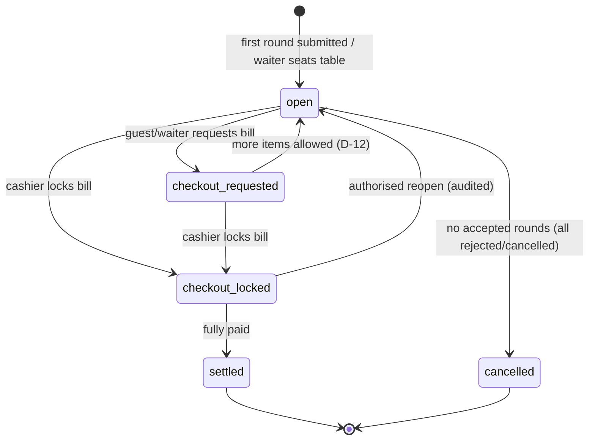
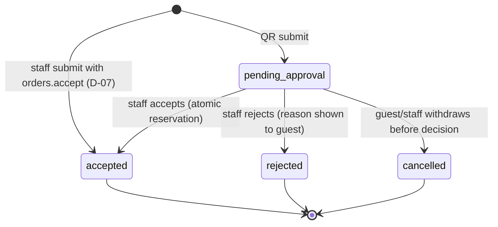
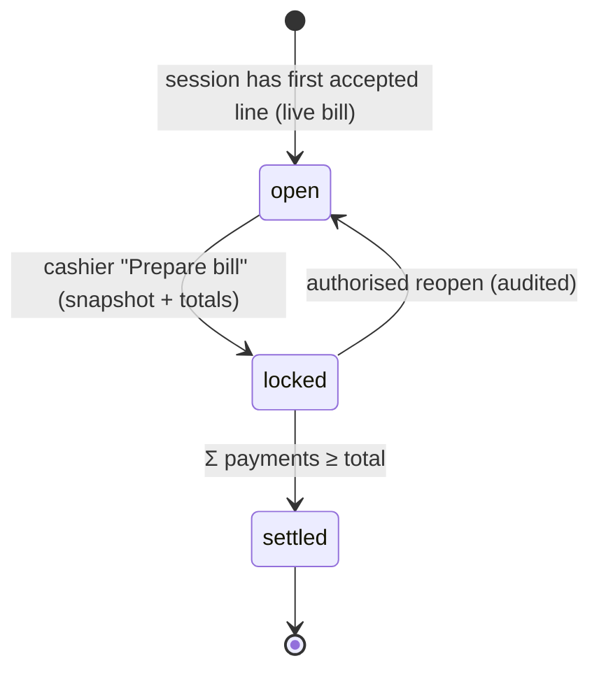

# 04 — Order, Inventory & Checkout Workflows

> Phase 0 · Draft. Items marked **D-xx** depend on an owner decision (see `10-decision-register.md`). Where a default is shown it is a recommendation, **not** an approved policy.

## 4.1 Separate state machines (resolves G-04)

The SRS's single chain `Submitted → Pending → Accepted → In Preparation → Ready → Delivered` is split into independent state machines. **No entity uses one status column for several concerns.**

### Dining session (drives table occupancy)



**Table display state is derived, never stored separately:** `Blocked/Maintenance` (table availability flag) › `Paying` (checkout_locked) › `Bill requested` › `Occupied` (open) › `Available` (no active session). An optional `Needs cleaning` step after settlement is D-10.

### Order round (approval only)



A round's *fulfilment* is not a round status. It is summarised from its lines ("2 of 3 ready").

### Order line fulfilment (quantity-aware)

Each line has counters, so a line of `qty = 3` can be partly ready, partly served, partly cancelled:

| Counter | Meaning | Moves when |
|---|---|---|
| `qty` | Accepted quantity | Fixed at acceptance |
| `qty_ready` | Prepared (= consumed) | KDS "Ready" (D-15). **Consumption event.** |
| `qty_served` | Handed to guest | Waiter "Served" |
| `qty_cancelled_unprepared` | Cancelled before ready | Reservation released |
| `qty_cancelled_prepared` | Cancelled/comped after ready | Waste/comp classification, no stock credit |

Derived `fulfil_status`: `queued` → `in_preparation` (kitchen started) → `ready` → `served`, or `cancelled` when all quantity is cancelled. Invariant: `qty_ready + qty_cancelled_unprepared ≤ qty`, `qty_served + qty_cancelled_prepared ≤ qty_ready`.

### Kitchen ticket

`new → preparing → ready → completed` (bumped), plus `cancelled`. Corrections are **new tickets** (`kind = correction | void`) that reference the original. The original is never edited.

### Invoice and payment



Payments and refunds are append-only events against the invoice, not invoice states.

### Stock reservation

`active` (created at acceptance) → `closed` when `qty_consumed + qty_released = qty_reserved`. Reservations never expire on a timer (INV-016). Stale reservations (e.g., accepted line not ready after N hours) raise an alert for a manager to resolve explicitly.

---

## 4.2 QR dine-in flow (end to end)

```mermaid
sequenceDiagram
  autonumber
  participant G as Guest phone
  participant API as API (customer listener)
  participant DB as PostgreSQL
  participant ST as Staff (approval queue)
  participant K as KDS / printer
  participant C as Cashier
  G->>API: GET /t/{qrToken}
  API->>DB: resolve token hash → table; find/create active session (table row lock)
  API-->>G: set guest cookie (session-bound token), menu + availability
  G->>API: POST /api/customer/rounds (Idempotency-Key, cart, quoted prices)
  API->>DB: tx: insert round PENDING + lines (server prices), event, outbox
  API-->>G: 201 round R-0042 "Waiting for staff"
  DB-->>ST: SSE hint → approval queue refetch
  ST->>API: POST /api/staff/rounds/{id}/accept (Idempotency-Key)
  API->>DB: tx: lock session/round/balances → revalidate → reserve → tickets → print jobs → outbox
  API-->>ST: 200 accepted (or 409 INSUFFICIENT_STOCK with per-line detail)
  DB-->>K: SSE hint + worker prints KOT (no prices)
  K->>API: POST lines/{id}/ready {qty, eventKey}
  API->>DB: tx: consume reserved qty once, release reservation, cost snapshot
  DB-->>G: SSE hint → "Ready"; waiter marks Served
  G->>API: POST request-bill → session checkout_requested
  C->>API: lock bill → take payment(s) → settle → session closed, guest tokens revoked
```

**Notes per step:**

1. **QR resolution.** The QR contains only an opaque table token. The server maps it to the table; the client never sends a table ID.
2. **Session join (D-09).** Recommended default: a scan at an occupied table **joins** the active session (same party). Staff see the number of joined devices. A waiter can "reset table guests" to revoke all guest tokens if a party left without the session being closed. Alternative: a 4-digit table join code shown by the waiter (stronger isolation, more friction).
3. **Availability shown to guests is advisory.** It's computed from current `available` stock (with no reservation for pending rounds), so an item may become unavailable before staff accept. The guest is told this on rejection.
4. **Submission.** Prices are computed **server-side** from the catalog. The client's displayed total is stored as `quoted_total` to detect drift. Lines have notes (length-limited, sanitised). Rate limit: e.g., ≤ 3 pending rounds per session and ≤ 10 submissions/min per guest token.
5. **Approval queue and routing (decided D-07).** Shows table, round number, age, items, notes, and a pre-check of stock (advisory). Actions: **Accept** and **Reject (reason)**. Routing:
   - Dine-in round at a table **assigned** to a waiter → that waiter's queue.
   - Dine-in round at an **unassigned** table, and every takeaway/delivery round → **cashier** queue.
   - **Managers** see every pending round and can accept or reject any of them.
   - **Escalation (D-36, recommended):** a round still pending after 3 min is highlighted to managers and cashiers, and cashiers may then accept it.
   - The server re-checks the right to accept **inside** the acceptance transaction. The queue is only a view.
   - Several staff may see the same round (assigned waiter + manager). **Exactly one acceptance can succeed** (conditional update under row lock, unique event key). The others immediately see "Accepted by Sara at 14:02", with no second ticket and no second reservation (C-1).
   - Table assignment: managers/cashiers assign waiters to tables on the floor plan (one current waiter per table). Assignments are audited.
6. **Acceptance transaction.** See 03-data-model §3.5. If prices rose since submission, the **price-lock rule** applies (D-08). Recommended: honour the quoted price if the catalog changed within the last 30 min, recording the difference as a system price-lock adjustment. Never charge more than the guest saw without the guest re-confirming.
7. **Insufficient stock (decided D-06).** Acceptance fails as a whole and returns which lines/ingredients are short. Staff **reject the whole round** with a reason ("Oat milk unavailable"). The guest sees the reason and can resubmit without that item. Staff never edit the guest's round.
8. **Kitchen.** One ticket per accepted round, kind `new` for the first round and `supplement` for later rounds of the same session (printed header "ADD-ON · Table 5 · Round 3"). **Decided topology:** the ticket prints on the **counter printer** (no prices, "KITCHEN" header) and is carried to the kitchen.
9. **Picked up = Ready = consumption (decided D-33).** There is no kitchen device. When the waiter or cashier collects items from the kitchen, they tap **Picked up** for a line, a quantity, or the whole ticket. That tap is the prepared event: consumption posts once per event key. Details:
   - **Dine-in:** by default, Picked up also marks the line **Served**, because the waiter carries it to the table. This can be configured to require a separate Served tap.
   - **Takeaway:** Picked up → then **Collected** when handed to the guest. **Delivery:** Picked up counts towards `ready_for_dispatch`.
   - **What guests and staff see:** Accepted → "Being prepared" (shown automatically after acceptance, since nobody records the kitchen start) → Picked up/Served. Stock reflects use only from pickup, so items made but not yet collected still show as reserved.
   - **Uncollected items:** a line accepted but not picked up after a configurable time (default 30 min) raises an alert on the waiter/cashier screens, so reservations don't stay open by mistake.
   - **Cancelling before pickup:** the system can't know whether the kitchen already made the item. The cancel dialog therefore asks **"Was it already made?"** If yes, the cancel is recorded as prepared + waste (stock consumed). If no, the reservation is released. This prevents stock drift.
   - The **Kitchen role** and KDS screens stay in the design but are inactive. A kitchen device can be added later with no data changes.
10. **Served.** Waiter marks served (or the KDS "completed" bump marks all ready lines served, configurable).
11. **More rounds.** Same session, new round, new ticket, same live bill.
12. **Bill request → checkout.** See §4.6.

## 4.3 Waiter flow

1. Waiter logs in on a registered device (PIN quick-switch on shared tablets, D-24).
2. Floor plan shows derived table states and pending-approval badges.
3. Tap table → session (create on first round, with optional guest count) → order composer.
4. Compose: search/categories, variant picker, modifier tray, notes, +/− quantity, "repeat last round" shortcut.
5. Submit with an idempotency key. Staff-entered rounds **go straight to the kitchen** (decided D-07): submission and acceptance happen **in one transaction**. If stock is short, nothing is saved and the composer highlights the affected lines while keeping the cart.
6. Waiter can also approve guests' pending QR rounds for their tables.
7. Edits after acceptance: **no in-place edits**. Options are "cancel quantity" (before ready, reservation released, correction ticket) and "add new round". After ready: "void/comp" with reason and permission.

**Concurrent waiters:** every write is a separate round or a quantity-counter transition under row lock, so two waiters can't overwrite each other. A waiter whose screen is stale gets `409 STALE_STATE` with the fresh state, never a silent overwrite.

## 4.4 Takeaway and delivery (designed from the 19 Oct 2026 decisions)

### Takeaway (D-05b: pay first; counter QR yes)

**A. Walk-in at the counter.** The cashier composes the order (optional customer name for call-out), collects cash or the HBL card payment, and presses **Accept & pay**. One transaction reserves stock, accepts, settles and prints the kitchen ticket + receipt (03-data-model §3.5). If stock is short, nothing is saved and the screen says **"No payment recorded. Return the money."**

**B. Guest uses the counter QR.**
1. The guest scans the printed counter QR and gets their **own** takeaway session (not shared with other guests).
2. They build a cart (optional name) and submit → round **pending approval**, shown in the **cashier queue** marked **UNPAID**. The phone shows "Order T-0123. Please pay at the counter."
3. The guest pays at the counter. The cashier opens T-0123 → **Accept & pay** (same atomic step as A).
4. If an item is out of stock, the round is **rejected whole** (D-06) with a reason, and the guest can reorder.
5. Unpaid pending orders auto-cancel after **30 min** (D-40). Pending orders hold no stock, so this has no inventory effect.
6. The session is **settled before the food is ready**. That's expected: payment state and fulfilment state are separate, so the kitchen and the guest's status page continue normally until **Ready** and **Collected**.

Recipes may include takeaway packaging components (`applies_to_order_types`).

### Delivery (D-05)

**Intake.** Phone, WhatsApp and walk-in requests are all **entered by staff** (normally the cashier). There is no guest delivery channel (guests are only on the LAN when they're in the shop). Name, phone, e-mail and address are **all optional**; the form shows a non-blocking hint when both phone and address are empty. **No delivery fee.** Staff-entered rounds go **straight to the kitchen** (D-07).

**Statuses** (proposed from common food-delivery practice: placed → confirmed → preparing → on the way → delivered):

```mermaid
stateDiagram-v2
  [*] --> confirmed: staff enters & accepts (stock reserved)
  confirmed --> preparing: kitchen starts (or first line ready)
  preparing --> ready_for_dispatch: all lines Ready
  ready_for_dispatch --> out_for_delivery: rider assigned, bill locked
  out_for_delivery --> delivered: rider returns — handover recorded
  out_for_delivery --> failed: rider reports failure
  failed --> out_for_delivery: manager — re-attempt
  failed --> cancelled: manager — cancel (prepared items → waste; refund if prepaid)
  failed --> converted_to_pickup: manager — customer will collect
  delivered --> [*]
  cancelled --> [*]
```



`confirmed`, `preparing` and `ready_for_dispatch` are **derived** from line fulfilment. Only dispatch, delivered, failed and the manager resolutions are delivery-specific events (`delivery_events`).

**The LAN constraint for riders.** The system runs only on the shop network, so a rider on the road **can't** update anything. Statuses are therefore recorded in the shop:
- **Dispatch:** the cashier selects the rider (a staff profile; no login needed, D-41) → `out_for_delivery`.
- **Return:** the cashier records **Delivered** (with optional actual delivery time) or **Failed** (with reason), and for COD records the cash handed over.

**Payment modes:**

| Mode | Flow |
|---|---|
| Prepaid | Paid before dispatch: cash or HBL card at the counter, or **bank transfer / JazzCash / Easypaisa** (D-37). For a transfer, staff check that the money has arrived in the shop's account/app, then record provider + transaction ID. The system cannot verify transfers itself. Dispatch requires a settled invoice. |
| Cash on delivery | Bill is **locked at dispatch** (amount fixed, printed on the receipt the rider carries). On return, the cashier records a cash payment linked to the rider, in the cashier's current shift → invoice settled → `delivered`. Outstanding COD by rider is shown live and on shift close and day-end reports. |
| Card on delivery | **Decided (D-37): a portable card terminal is available.** The bill is locked at dispatch; the rider takes the terminal. On return, the cashier records a card payment with the slip reference, linked to the rider → settled → `delivered`. If the card is declined at the door, the rider may collect cash instead, and the cashier records whatever was actually received. |

**Failed delivery (manager handles).** A failed delivery waits in the manager's inbox. Options: **re-attempt**, **convert to pickup**, or **cancel**. Cancel keeps the stock consumption (food was prepared) and classifies it as waste with reason "failed delivery". A prepaid order is refunded through the normal refund flow. No stock is credited back.

## 4.5 Cancellation, void, comp and refund matrix

| Stage | Action | Permission (default) | Stock effect | Kitchen effect | Billing effect |
|---|---|---|---|---|---|
| Pending approval | Guest withdraws / staff rejects | Guest (own round), `orders.accept` | None | None | None |
| Accepted, not ready | Cancel quantity | `orders.void` (waiter: own tables, D-13) | Release reservation exactly once | Correction ticket printed + KDS banner | Line quantity not billable |
| Ready/served | Void as waste (e.g., remade) | `orders.void_prepared` (manager) | **None** (already consumed); classified as waste with cost | None | Not billable |
| Ready/served | Comp (free to guest) | `discounts.comp` (manager) | None; cost stays in COGS as "comp" | None | 100 % line discount with reason |
| Bill locked | Reopen bill | `invoices.reopen` | — | — | Invoice back to `open`, audited |
| Settled | Refund (full/partial) | `payments.refund` + step-up approval | None by default | None | Refund record + ledger reversal; **settled invoice unchanged**; receipt for refund |
| Settled | Correct payment method (cash↔card) | `payments.correct` + approval | None | None | Reversal + new payment entry, both visible |

## 4.6 Checkout, payment and table release

1. Bill request (guest or waiter) → session `checkout_requested`. Default (D-12): new guest rounds are still allowed but flagged "after bill request" to staff. The alternative blocks them.
2. Cashier opens the live bill (all billable accepted lines across rounds, grouped by round, prior rounds read-only).
3. **Prepare bill (lock):** blocked if any round is still `pending_approval` (staff must accept/reject first). It warns, without blocking, about lines accepted but not yet served (D-12). Snapshot to `invoice_lines`, apply discounts within the cashier's limit (above the limit → manager PIN step-up), compute totals. Session → `checkout_locked`. New QR submissions now get "Your bill is being prepared, please ask staff".
4. **Take payment:** cash (tendered → change shown large), manual card (amount + optional slip reference), or transfer: bank / JazzCash / Easypaisa with a required transaction ID after staff confirm receipt (D-37). Card and transfer amounts are excluded from expected drawer cash at shift close. Multiple tenders allowed (D-13). Each payment carries an idempotency key **and** the invoice `lock_version`. If the bill was reopened and changed in between, the payment is refused with `409 BILL_CHANGED`.
5. **Settle** when fully paid: invoice number assigned, session settled, guest tokens revoked, table released, ledger entries posted, receipt printed. (No cash drawer is installed (D-03), so there is no drawer kick.)
6. **Reprint:** labelled "REPRINT #n", permissioned, audited.

## 4.7 Inventory flows

| Flow | Steps | Key rule |
|---|---|---|
| Opening balance | Clerk enters counts per item/lot with cost → manager approves → `opening` movements | One-time per item; later changes are count adjustments |
| Receiving (GRN) | Scan barcode → resolves exact item + pack size → enter pack qty, cost, lot, expiry → post | Unknown barcode → "link to item" flow (permission); duplicate barcode → blocked with the conflicting item shown |
| Reservation | At acceptance (see §4.2) | Only non-expired, non-quarantined stock counts as available |
| Consumption | At Ready; FEFO lot picking for lot-tracked items | If lots are insufficient at prep time (e.g., a lot expired minutes ago), consume anyway from the reserved item quantity, flag `expired_lot_used` and alert. Physical reality wins and is recorded truthfully. |
| Waste (ingredient) | Clerk/kitchen records item, lot, qty, reason | Creates `waste` movement with cost |
| Expiry | Nightly + on-demand job marks lots expired → excluded from availability → alert; disposal recorded as waste | Never auto-deletes stock |
| Stock count | Draft → counted → submitted → approved (threshold D-18) → posted as adjustments | Book quantity snapshotted at count start; movements during the count are reconciled by the posting logic |
| Supplier return | Negative receipt movement referencing the original receipt line | Cost per D-04 |

## 4.8 Idempotency & duplicate prevention design

**Three layers, all required:**

1. **Client intent keys.** Every mutating request that creates or moves value (submit round, accept, ready, cancel, lock, pay, refund, receipt post, count post) carries an `Idempotency-Key` (UUID v4). The key is generated **when the user commits the intent** (e.g., taps Submit) and persisted locally until a definitive response arrives, so a page refresh followed by a retry reuses it. Buttons disable while a request is in flight.
2. **Server idempotency record in the same transaction.** The service inserts `idempotency_keys(scope, key, request_hash, response)` **inside the business transaction**. If the transaction commits, the key and the effect commit together. If it rolls back (crash, conflict), neither exists and a retry runs cleanly. A concurrent duplicate blocks on the unique key and then returns the stored response. The same key with a different payload returns `409`.
3. **Natural business guards.** Even without a key, conditional state transitions (`WHERE status = 'pending_approval'`), unique source keys on movements/ledger/print jobs, and per-line counters with CHECK constraints make duplicates impossible at the data level.

## 4.9 Concurrency scenarios

| # | Race | Mechanism | Outcome |
|---|---|---|---|
| C-1 | Two staff accept the same round | Round row lock + conditional update | First accepts; second gets `200 already_accepted` with acceptor's name (no second reservation/ticket) |
| C-2 | Two rounds compete for the last 300 ml of milk | Balance rows locked in item-id order | First reserves; second fails `INSUFFICIENT_STOCK`; available never < 0 |
| C-3 | Two guests at an empty table scan simultaneously | Table row lock + partial unique index | One session; both guests join it |
| C-4 | Guest submits while cashier locks the bill | Session row lock | Whichever commits first wins; lock refuses while a round is pending; submission refused once locked |
| C-5 | Kitchen marks Ready while waiter cancels the same quantity | Line row lock + counter CHECKs | Exactly one succeeds for each unit; the other gets `409` with fresh state |
| C-6 | Two cashiers pay the same invoice | Invoice lock + `lock_version` + remaining-due check | Second payment refused if it would overpay; no duplicate settlement |
| C-7 | Price edited while round pending | Price-lock rule at acceptance (D-08) | Guest is never silently charged more |
| C-8 | Recipe edited while round pending | Acceptance snapshots the **then-active** recipe | Historical lines unaffected by later edits |
| C-9 | Count posted below reserved quantity | Adjustment allowed; shortfall alert; acceptance blocked for that item | Truthful stock; manager resolves |
| C-10 | Two managers edit the same menu item | `expectedVersion` optimistic check | Second gets `409` with diff, no lost update |

## 4.10 Failure recovery

| Failure | Behaviour |
|---|---|
| Client times out after the server committed | Retry with the same key returns the original response; UI shows final state |
| API crashes mid-transaction | PostgreSQL rolls back; retry executes cleanly |
| API restarts | Clients reconnect SSE, resync views; nothing in memory is authoritative |
| Worker crashes while printing | Job lease expires. A job that may have already sent bytes is **not blindly retried**: it goes to `uncertain` and shows a one-tap "Reprint (marked REPRINT)" on KDS/reception. This avoids silent duplicate kitchen tickets while not losing any. Jobs that never started are retried automatically. |
| Printer offline / paper out | Job `failed → retrying` with backoff; visible error; KDS screen unaffected |
| SSE events missed | `Last-Event-ID` replay or full resync; UI never relies on an event to know state |
| Email provider unreachable | Delivery stays `queued`, retried with backoff; status visible. SMTP is **at-least-once**: a connection drop after the server accepted the message can cause a duplicate on retry. Mitigated with a stable `Message-ID`; it cannot be fully eliminated. |
| Power loss on host | Committed transactions survive (WAL, `fsync=on`); services auto-start on power-on; clients reconnect |
| Balance drift detected by nightly reconciliation | Critical alert to owner; no automatic "fix"; investigation tool shows the per-item movement trail |
