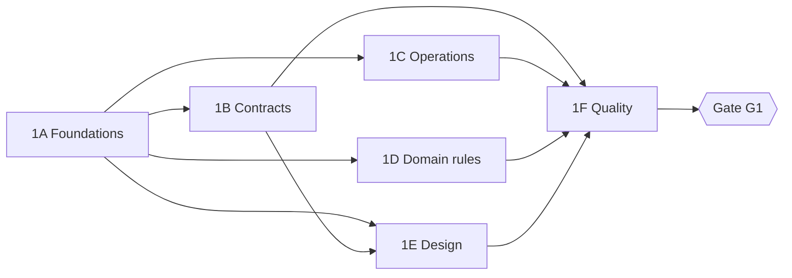

# Phase 1 — UX & Architecture Design Plan

| | |
|---|---|
| Started | 19 Oct 2026, after owner approval of Gate G0 |
| Ends at | **Gate G1**: owner sign-off on designs, database, state machines, permissions, contracts and operations plans |
| Rule | Design only. No application code or migrations. SQL in these documents is a **design specification**, reviewed before it becomes migrations in Phase 2. |

## Review packages

Phase 1 is delivered in six packages, each reviewed by the owner. Provisional defaults (D-08 … D-32) are confirmed at the review listed against each in [DECISIONS.md](../DECISIONS.md).

| Package | Contents | Output files | Review |
|---|---|---|---|
| **1A Foundations** ✅ delivered 19 Oct | Decision log, database design, state machines, permission catalog | `docs/DECISIONS.md`, `docs/DATABASE.md`, `docs/ORDER_STATE_MACHINE.md`, `docs/RBAC.md` | ✅ approved at G1 |
| **1B Contracts** ✅ delivered 19 Oct | REST API for the Phase 3 order-to-cash slice, realtime (SSE) event contract, error codes, idempotency rules | `docs/API.md`, `docs/openapi/phase3.yaml` | ✅ approved at G1 |
| **1C Operations** ✅ delivered 19 Oct | LAN/router setup checklist, printing plan for the single counter printer, Windows services and installer, security, backup & restore runbook | `docs/LOCAL_LAN_HOSTING.md`, `docs/PRINTING_HARDWARE.md`, `docs/WINDOWS_DEPLOYMENT.md`, `docs/SECURITY.md`, `docs/BACKUP_RECOVERY.md` | ✅ approved at G1 |
| **1D Domain rules** ✅ delivered 19 Oct | Recipes, UOM, reservation/consumption, WAC costing rules, KPI definitions, data-entry templates for the clerk | `docs/RECIPE_INVENTORY.md`, `docs/COST_VALUATION.md`, `docs/FINANCE_REPORTING.md`, `docs/templates/*.csv` | ✅ approved at G1 |
| **1E Design** ✅ delivered 19 Oct | Design tokens, component specs, screen designs and clickable prototypes for the priority journeys | `docs/UI_UX.md`, `docs/prototypes/project/*.dc.html` (canvas: https://claude.ai/artifact/S6w3NNiGLC8Vx3L6BJnPPU) | ✅ approved at G1 |
| **1F Quality** ✅ delivered 19 Oct | Test plan with requirement → test traceability (checked by `corepack pnpm check:trace`) | `docs/TEST_PLAN.md`, `docs/traceability.csv` | **G1 approved 19 Oct 2026** (see `docs/phase-1/G1_SIGNOFF.md`) |

## Dependencies

## Inputs still needed (not blocking 1A)

| Item | Needed by |
|---|---|
| Printer rear-port photo + self-test page (D-03, deferred) | 1C printing plan (provisional until received); final before Phase 3 |
| Router screenshots, passwords blurred (D-11) | 1C LAN checklist (provisional until received) |
| Design file format: Figma vs interactive HTML prototypes (D-30) | 1E |

## Open review points

| Review | Point | Proposed |
|---|---|---|
| R1 | Answers outstanding for DATABASE.md §15 and the R1-tagged provisional defaults in DECISIONS.md | — |
| R2 | Guest access lifetime; step-up validity; guest rate limits; showing the accepting staff name to guests (API.md §9) | 12 h; 2 min; 10/min + 3 pending; no |
| R3 | Counter Windows account logs in automatically after power cuts (WINDOWS_DEPLOYMENT.md H-10) | Yes, standard account; app still needs staff PIN |
| R3 | Two rotating backup drives (one at home), plus daily cloud copy of the nightly dump when online (BACKUP_RECOVERY.md §3) | Yes (refines provisional D-23) |
| R3 | Accept residual risks SR-3 (guest HTTP), SR-5 (no disk encryption), SR-6 (personal phones) (SECURITY.md §4) | Accept |
| R3 | Print English item names only on paper; Urdu printing later as an image option (PRINTING_HARDWARE.md §3) | Yes |
| R3 | Printer rear-port photo + self-test page and router screenshots (passwords blurred) | Needed before Phase 3 printing work and before QR codes are printed |
| R4 | Recipe can be activated only when **all** its ingredients have opening stock (RECIPE_INVENTORY.md §2) | Yes |
| R4 | Supplier price corrections split by current stock ÷ received quantity (COST_VALUATION.md §6) | Yes (documented approximation) |
| R4 | Headline margin = gross profit **after** waste and stock variance; staff meals recorded as waste; weeks Mon–Sun; cashiers see own shift total (FINANCE_REPORTING.md §9) | Yes to all |
| R4 | Confirm the KPI definitions in FINANCE_REPORTING.md §3 (provisional D-21) | — |
| R5 | Fonts Fraunces + IBM Plex Sans; tablet two-pane / phone one-pane waiter layout; Picked up = one tap + 5 s Undo (request held on device); unavailable items greyed not hidden; owner headline tiles (UI_UX.md §10) | Yes to all |
| R6 | Performance and recovery targets in TEST_PLAN.md §8 are accepted as proposals until measured on the counter iMac | Yes |
| R6 | Two scripted ~90-minute UAT service sessions with real staff (one with internet disconnected) in Phase 7 | Yes; owner to schedule staff time |
